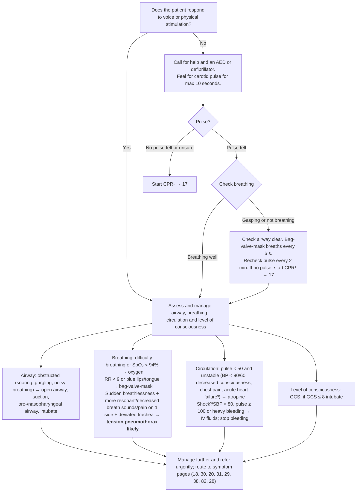

# Page 16 – The emergency patient: flowchart

Source: APC 2026 e-book, page 16 (red box "Give urgent attention to the emergency patient").

Footnotes: ¹ life-limiting illness: consider whether to proceed (→ 193). ² jaw-thrust technique.
³ (first) acute heart failure = leg swelling, difficulty breathing which worsens on lying down/with effort.
³ (second; the page numbers two footnotes "3") If SBP < 80, pulse ≥ 100, respiratory rate > 30,
confusion/restlessness, weakness, **shock likely**.

## Decision nodes → rules

| Node | Modelled as | Rule |
|---|---|---|
| Entry: "the emergency patient" | Any page entry feature that the app records: unresponsive (Q1 = No), cardiac arrest, obstructed airway, difficulty breathing, SpO₂ < 94, RR < 9, SBP < 80, pulse < 50 | `Check for emergency patient airway, breathing, circulation signs` (trigger); first `or` of `Emergency: the emergency patient with airway, breathing, circulation or consciousness compromise` |
| Q1 = No | `Unresponsive` (an AVPU vital assessment option) | trigger and priority criterion |
| No pulse felt or unsure → CPR | `Absent pulse` or `Cardiac arrest` | priority criterion |
| Gasping or not breathing | `Apnea`, `Agonal respiration`, `Gasping for breath` | priority criterion |
| Airway obstructed | `Respiratory obstruction`, `Snoring`, `Gurgling`, `Noisy respiration` | priority criterion |
| Difficulty breathing / SpO₂ < 94% | `Difficulty breathing`, SpO₂ < 94 | priority criterion |
| RR < 9 or blue lips/tongue | RR < 9, `Blue lips`, `Blue tongue` | priority criterion |
| Tension pneumothorax likely | sudden-onset dyspnoea **and** (unilateral hyperresonance / decreased breath sounds / chest pain) **and** displaced trachea | `Diagnose probable tension pneumothorax (emergency patient)`; `(active_condition Tension pneumothorax)` in the priority |
| Pulse < 50 and unstable | pulse < 50 **and** any of SBP < 90, DBP < 60, decreased consciousness, chest pain, acute heart failure features (leg swelling, orthopnoea, dyspnoea on exertion) | priority criterion |
| Shock likely (footnote 3) | any of SBP < 80, pulse ≥ 100, RR > 30, acute confusion, restlessness, asthenia | `Diagnose probable shock (emergency patient)` |
| Shock/SBP < 80, pulse ≥ 100 or heavy bleeding | `(active_condition Shock)`, SBP < 80, pulse ≥ 100, severe bleeding | priority criterion |
| GCS ≤ 8 | not representable (no unit for a GCS score) | none — see remaining questions |
| Management, CPR, routing | not modelled (no `manage` tasks this pass) | none |
