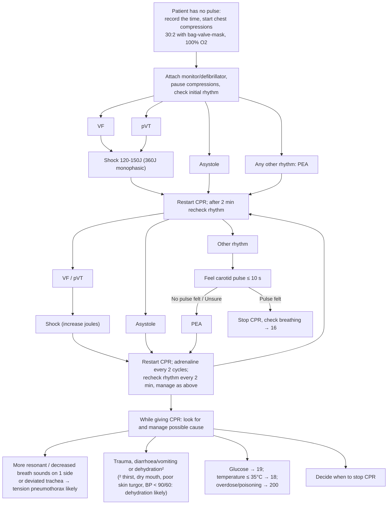

# Page 17 – Cardiopulmonary resuscitation (CPR): flowchart

Source: APC 2026 e-book page 17 (red box).

## Decision nodes → rules

| Node | Modelled as | Rule |
|---|---|---|
| Patient has no pulse | `(or Cardiac arrest, Absent pulse)` → Emergency | `Emergency: no pulse, start CPR` |
| Look for possible cause (trigger) | Same `or` as the task's `due_to` | `Check for reversible causes during CPR` |
| Tension pneumothorax likely | no pulse **and** any of unilateral hyperresonance, unilateral decreased breath sounds, trachea displaced | `Diagnose probable tension pneumothorax during CPR` |
| Dehydration likely (footnote 2) | no pulse **and** any of thirst, xerostomia, decreased skin turgor, SBP < 90, DBP < 60 | `Diagnose probable dehydration during CPR` |
| Rhythm branches (VF, pVT, asystole, PEA), pulse check, shocks, adrenaline | Not modelled: they route only to management | — |
| Glucose / temperature / overdose pointers | Cross-references to pages 19, 18, 200 | — |
| Decide when to stop CPR | Not modelled: management decision | — |
