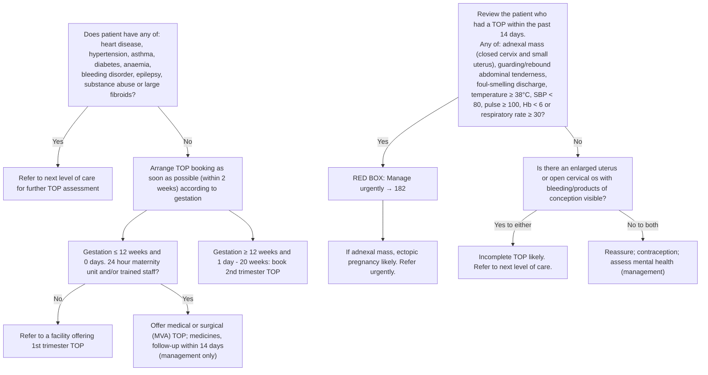

# Page 176 – Manage the patient requesting a termination of pregnancy (TOP): flowchart

Source: `inputs/2026/p176.png`. The red box is the "Yes" branch of the lower section, **Review the
patient who had a TOP within the past 14 days**. The upper part of the page (choosing and
providing medical or surgical TOP by gestation and facility) is management and referral routing
only; it is drawn here for context but is not encoded.

## Decision nodes → rules

| Node | Modelled as | Rule |
|---|---|---|
| Review the patient who had a TOP within the past 14 days | `(<= (onset (clinical_finding Induced termination of pregnancy)) (time_ago 14 days))` as the trigger | `Check for complications after recent termination of pregnancy` |
| R = Yes (red box, "Manage urgently") | Trigger **and** any of: mass of uterine adnexa, abdominal guarding, rebound tenderness, offensive vaginal discharge, temperature ≥ 38 °C, SBP < 80, pulse ≥ 100, respiratory rate ≥ 30. Hb < 6 not representable | `Urgent: complications after recent termination of pregnancy` |
| "If adnexal mass, ectopic pregnancy likely" | Trigger **and** mass of uterine adnexa | `Diagnose probable ectopic pregnancy after recent termination of pregnancy` |
| R = No → Q2 = Yes to either, "incomplete TOP likely" | Trigger **and** (enlarged uterus **or** (cervical os open **and** (bleeding from vagina **or** products of conception at os))) | `Diagnose probable incomplete termination of pregnancy` |
| Q2 = No to both; upper half of page | Management / referral routing | not encoded |

## Notes

- "Within the past 14 days" is written as `<=` (the database rejects `<` in onset comparisons).
- The "No" branch precondition (none of the danger signs) is not required by the incomplete-TOP
  rule; the danger signs themselves already make the patient Urgent.
