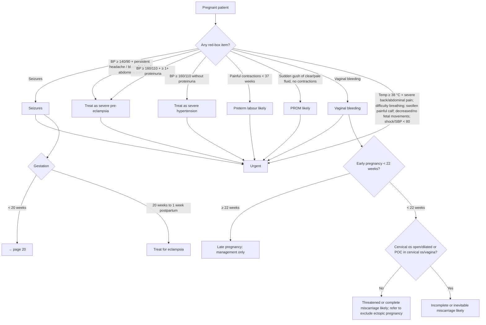

# Page 177 – Routine antenatal care: flowchart

The whole page sits inside the red box. The urgent-attention list feeds one priority rule; the
columns below it are mainly management, except the vaginal-bleeding Yes/No question, which yields
the miscarriage/ectopic diagnoses.

| Node | Rule(s) in `177-routine-antenatal-care.lisp` |
|---|---|
| Pregnant patient → red-box checks | task "Check for urgent routine antenatal care conditions" |
| Any red-box item → Urgent | priority "Urgent: pregnant patient with antenatal danger signs" |
| Treat as severe pre-eclampsia | diagnosis "Diagnose probable severe pre-eclampsia in antenatal patient" (referenced by the priority rule) |
| Treat as severe hypertension | inlined in the priority rule (no SNOMED concept) |
| Preterm labour likely | diagnosis "Diagnose probable preterm labour in antenatal patient" (gestation < 37 weeks not representable) |
| PROM likely | diagnosis "Diagnose probable prelabour rupture of membranes in antenatal patient" |
| Treat for eclampsia | diagnosis "Diagnose probable eclampsia in antenatal patient with seizures" (gestation window not representable) |
| Early pregnancy < 22 weeks? | not representable; the bleeding rules below omit it |
| Os/POC question | task "Check for miscarriage signs in pregnant patient with vaginal bleeding" |
| No → threatened or complete miscarriage | "Diagnose possible threatened miscarriage in antenatal patient", "Diagnose possible complete miscarriage in antenatal patient" |
| No → refer to exclude ectopic | "Diagnose possible ectopic pregnancy in antenatal patient with vaginal bleeding" |
| Yes → incomplete or inevitable miscarriage | "Diagnose possible incomplete miscarriage in antenatal patient", "Diagnose possible inevitable miscarriage in antenatal patient" |
| < 20 weeks → page 20; late pregnancy branch | cross-reference / management only, not encoded |
