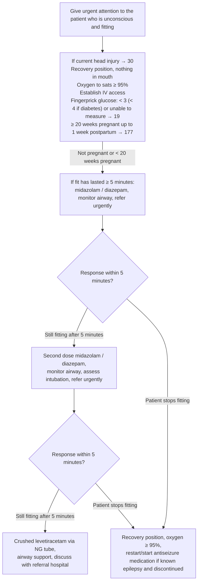

# Page 20 – Seizures/fits: flowchart

Source: `inputs/2026/p20.png` (one red box covering the whole algorithm).

## Decision nodes → rules

| Node | Modelled as | Rule |
|---|---|---|
| H (red box header): unconscious and fitting | `Seizure` (recorded warning sign) triggers a check for `Unconscious`; both together → Urgent | `Check for urgent seizure/fit conditions`, `Urgent: unconscious and fitting` |
| A: head injury → 30, glucose → 19, pregnancy → 177 | Pointers to other pages; not modelled here | none (`cross_reference_only`) |
| B: fit lasted ≥ 5 minutes | Treatment threshold for medication; the language has no seizure-duration observable (onset is not duration) | none (`management_step`) |
| R1 / R2: still fitting after 5 minutes / stops fitting | Treatment-response routing | none (`flowchart_routing`) |
| C, D, S | Medicines, airway support, referral | none (`management_step`) |
