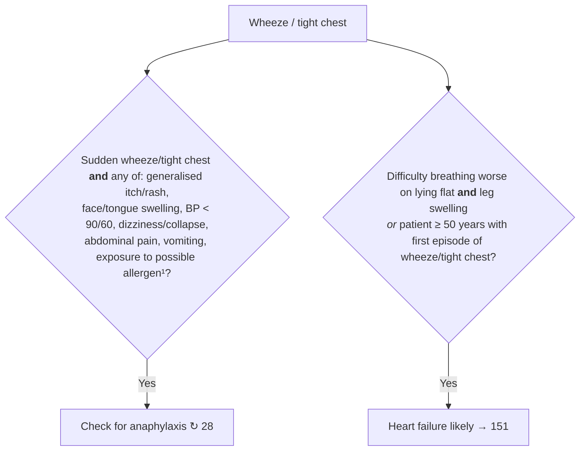
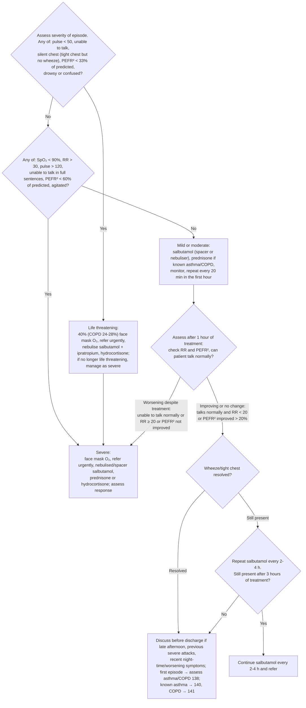

# Page 22 – Wheeze/tight chest: flowchart

Source: `inputs/2026/p22.png` (APC 2026, page 22): two bullets above the red box, and the red box.

## Bullets above the red box

¹ Common allergens include medication, food or insect bite/sting within the past few hours.

## Red box: "Give urgent attention to the patient with wheeze/tight chest"

² PEFR is expressed as a percentage of the predicted normal value for the patient's age and height ↻ 139.

## Decision nodes → rules

| Node | Modelled as | Rule |
|---|---|---|
| Presenting complaint | `Wheezing` or `Tight chest` (neither is a recorded common symptom or warning sign) | `Check for wheeze/tight chest severity and causes` (task trigger) |
| Silent chest needs a wheeze check | A patient presenting with tight chest is examined for wheeze | `Check for wheeze in tight chest` |
| PEFR² | Measure `Recorded/predicted peak expiratory flow rate ratio` in % | `Measure PEFR in wheeze/tight chest` |
| Header: urgent attention to every patient with wheeze/tight chest | `(or Wheezing Tight chest)` → Urgent | `Urgent: wheeze/tight chest` |
| S1 = Yes (life threatening) | complaint **and** any of: pulse < 50, unable to speak, tight chest with no wheeze, PEFR < 33% predicted, drowsy, acute confusion → Emergency | `Emergency: life-threatening wheeze/tight chest` |
| S1 = No → S2 = Yes (severe) | complaint **and** any of: SpO₂ < 90%, RR > 30, pulse > 120, unable to complete a sentence in one breath, PEFR < 60% predicted, agitated → Urgent | `Urgent: severe wheeze/tight chest` |
| S2 = No (mild/moderate) | No separate rule; covered by the base Urgent rule | `Urgent: wheeze/tight chest` |
| R1, R2, R3 (reassessment after 1 h / 3 h of treatment) | Not modelled: they route management after treatment and depend on time since treatment started | — (see remaining questions) |
| Anaphylaxis bullet | Sudden-onset wheeze/tight chest **and** any listed feature → `possible` anaphylaxis | `Diagnose possible anaphylaxis from sudden wheeze/tight chest` |
| Heart failure bullet | complaint **and** orthopnoea **and** leg swelling → `probable` heart failure; the age ≥ 50 + first-episode branch is not modelled (no age in the language) | `Diagnose probable heart failure from wheeze/tight chest` |

## Notes

- All management (oxygen, salbutamol, ipratropium, steroids, referral, discharge advice) is out of
  scope for this pass and is not modelled.
- "Life threatening" is the page's own explicit escalation, so that tier is `Emergency`. The
  severe tier stays `Urgent`, the level the header gives every patient with wheeze/tight chest.
