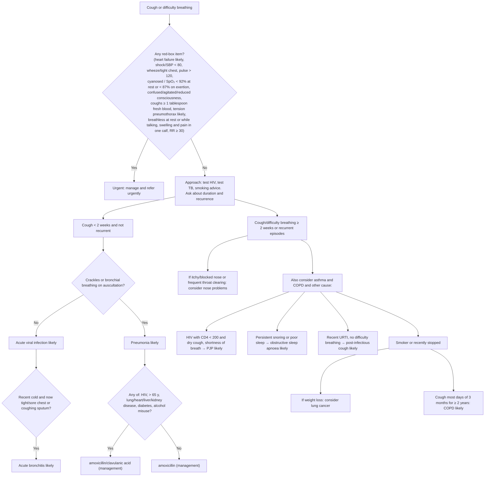

# Page 23 – Cough or difficulty breathing: flowchart

Source: APC 2026 e-book page 23 (`inputs/2026/p23.png`). The red box is a flat "any of" list; the
lower half is a branching algorithm on duration and recurrence.

## Decision nodes → rules

| Node | Modelled as | Rule |
|---|---|---|
| Red box, any item | `(and (or Cough, Difficulty breathing) (or …items…))` | `Urgent: cough or difficulty breathing with danger signs`; findings asked by `Check for urgent cough or difficulty breathing conditions` |
| Heart failure likely | Orthopnea **and** leg swelling | `Diagnose probable heart failure from cough or difficulty breathing` → `(active_condition Heart failure)` in the priority rule |
| Tension pneumothorax likely | Sudden-onset dyspnoea **and** (hyperresonance / decreased breath sounds / unilateral chest pain) **and** trachea displaced **and** BP < 90/60 | `Diagnose probable tension pneumothorax from cough or difficulty breathing` → `(active_condition Tension pneumothorax)` in the priority rule |
| Cough < 2 weeks and not recurrent | `(<= (onset Cough) (time_ago 2 weeks))` **and** `(no Cough + Recurrent)` | used inside the pneumonia, viral infection and bronchitis rules |
| Crackles/bronchial breathing = Yes | short branch **and** (respiratory crackles or bronchial breathing) | `Diagnose probable pneumonia from short cough with crackles or bronchial breathing` |
| Crackles/bronchial breathing = No | short branch **and** `(no crackles)` **and** `(no bronchial breathing)` | `Diagnose probable acute viral respiratory infection from short cough` |
| Recent cold + tight/sore chest or sputum | viral branch **and** common cold **and** (tight chest / chest pain / productive cough) | `Diagnose probable acute bronchitis from short cough after a cold` |
| Pneumonia risk-factor question | antibiotic choice only | not modelled (management) |
| ≥ 2 weeks or recurrent | `(or (>= (onset Cough) (time_ago 2 weeks)) (>= (onset Difficulty breathing) (time_ago 2 weeks)) Cough+Recurrent DifficultyBreathing+Recurrent)` | used inside every long-branch rule |
| Itchy/blocked nose, throat clearing | long branch **and** (itching at nasal structure / nasal congestion); throat clearing has no SNOMED finding | `Diagnose possible nose problem from long-standing cough` |
| Also consider asthma and COPD | long branch | `Diagnose possible asthma from long-standing cough or difficulty breathing`, `Diagnose possible COPD from long-standing cough or difficulty breathing` |
| PJP likely | long branch **and** known HIV **and** dry cough **and** dyspnoea (CD4 < 200 not representable) | `Diagnose probable PJP from long-standing dry cough in HIV` |
| OSA likely | long branch **and** (snoring or poor sleep pattern) | `Diagnose probable obstructive sleep apnoea from long-standing cough` |
| Post-infectious cough likely | long branch **and** URTI **and** `(no Difficulty breathing)` | `Diagnose probable post-infectious cough` |
| Smoker + weight loss | long branch **and** (smoker / ex-smoker) **and** weight decreased | `Diagnose possible lung cancer from long-standing cough in a smoker` |
| Smoker + cough ≥ 2 years | (smoker / ex-smoker) **and** `(>= (onset Cough) (time_ago 2 years))` | `Diagnose probable COPD from cough for 2 years in a smoker` |

## Notes

- "< 2 weeks" is written `<=` (VHA's database accepts only `>=`/`<=` in onset comparisons), so a cough
  of exactly 2 weeks sits in both branches.
- Management steps (oxygen, cannula, fluids, ceftriaxone for severe pneumonia, glucose check,
  antibiotics, paracetamol, referral) are not modelled.
