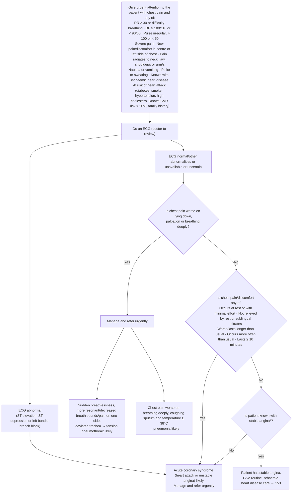

# Page 24 – Chest pain: flowchart

Source: `inputs/2026/p24.png` (APC 2026, page 24). The whole algorithm sits inside the red box.

¹ Chest pain caused by ischaemic heart disease.

## Decision nodes → rules

| Node | Modelled as | Rule |
|---|---|---|
| Presenting complaint | `Chest pain` (warning sign) | trigger of every task |
| Red box criteria | `(and Chest pain (or …))` over every red-box item | `Check for urgent chest pain signs`, `Record known cardiovascular disease risk for chest pain`, `Urgent: chest pain with danger signs` |
| Do an ECG | `check_for` ST segment elevation, ST segment depression, Electrocardiographic left bundle branch block | `Do an ECG for chest pain (doctor to review)` |
| ECG abnormal → ACS likely | Chest pain **and** any of the three ECG findings | `Diagnose probable acute coronary syndrome in chest pain`, first branch |
| Positional question (POS) | `Pain aggravated by position` (for lying down), `Tenderness of chest wall` (palpation), `Chest pain on breathing` (breathing deeply). "No" = all three recorded as No | `Check chest pain character for acute coronary syndrome` |
| POS = Yes → Manage and refer urgently | Chest pain **and** any of the three positional findings | `Urgent: chest pain worse on lying down, palpation or breathing deeply` |
| Tension pneumothorax likely | POS = Yes **and** sudden dyspnoea **and** one-sided sign (hyperresonance / decreased breath sounds / pain) **and** trachea displaced | `Check for tension pneumothorax or pneumonia in chest pain`, `Diagnose probable tension pneumothorax in chest pain` |
| Pneumonia likely | Chest pain on breathing **and** productive cough **and** temperature ≥ 38 °C | `Diagnose probable pneumonia in chest pain` |
| POS = No → FEAT = Yes → ACS likely | Chest pain **and** POS = No **and** any of: chest pain at rest, chest pain worsening, chest pain prolonged, onset ≥ 10 minutes ago | `Diagnose probable acute coronary syndrome in chest pain`, second branch |
| POS = No → FEAT = No → SA = No → ACS likely | Chest pain **and** POS = No **and** known stable angina recorded as No | `Diagnose probable acute coronary syndrome in chest pain`, second branch (see note) |
| SA = Yes → stable angina | Chest pain **and** no abnormal ECG finding **and** POS = No **and** each FEAT item negative **and** known stable angina | `Diagnose probable stable angina in chest pain` |
| ACS likely → Manage and refer urgently | `(active_condition Acute coronary syndrome)` | `Urgent: probable acute coronary syndrome in chest pain` |

## Notes

- The two "No" routes into ACS (FEAT = Yes, or FEAT = No and not known with stable angina) are
  written as one branch: POS = No **and** (any FEAT item **or** known stable angina = No). This is
  logically the same as the page, because FEAT = Yes already leads to ACS whatever the angina
  history.
- The ECG step is not a gate on the ACS "No" branches: an abnormal ECG leads to ACS anyway. It is a
  gate on the stable angina outcome, written as `(not (or …ECG findings…))` so that an unavailable
  or uncertain ECG still reaches that outcome, as the page says.
- "Occurs with minimal effort", "not relieved by rest or sublingual nitrates" and "occurs more often
  than usual" have no SNOMED concept; see the remaining-questions file.
- "Lasts ≥ 10 minutes" is read as chest pain onset at least 10 minutes ago.
- Management steps (oxygen, aspirin, IV access, nitrates, morphine, streptokinase and its
  contraindications, cannula/chest tube, fluids for shock, amlodipine, ceftriaxone) are not modelled.
