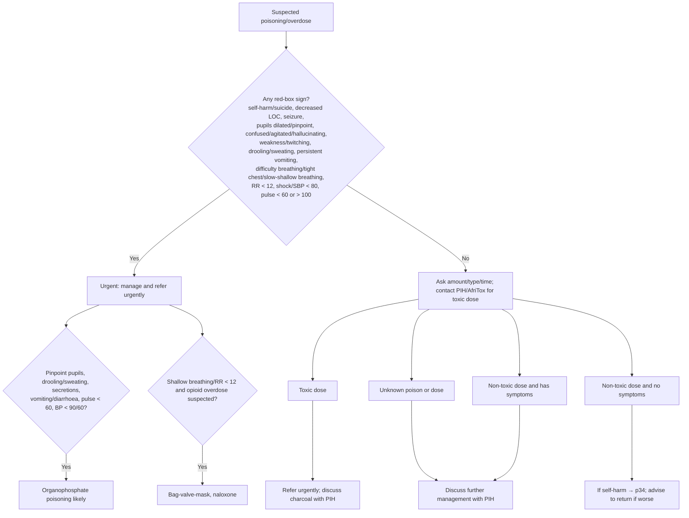

# Page 27 – Poisoning/Overdose: flowchart

The page has a red box (urgent criteria plus urgent management) and, below it, a four-way
algorithm for the patient not needing urgent attention, which depends on the toxic dose as
determined with the Poisons Information Helpline (PIH) or AfriTox.

| Node | Content | Rule |
|---|---|---|
| A | Presenting complaint | trigger of task "Check for urgent poisoning/overdose signs" |
| B | Red-box criteria | task "Check for urgent poisoning/overdose signs"; priority "Urgent: suspected poisoning/overdose with danger signs" |
| OP / OPL | Organophosphate features | "Diagnose probable organophosphate poisoning" |
| OD / NX | Opioid overdose suspected | not encoded (management; no evidence given for the suspicion) |
| C, T1–T4 | Toxic-dose routing | not encoded: toxic dose is not recordable, and the outcomes are management/referral |
