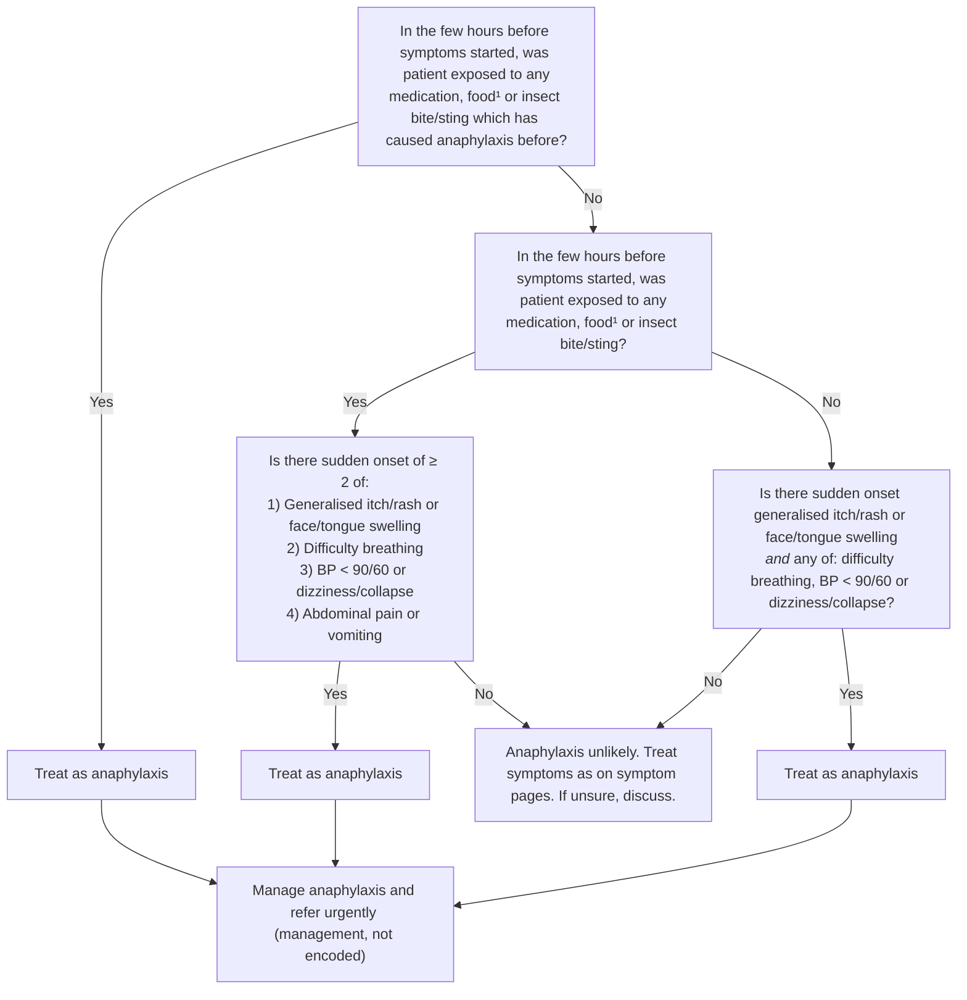

# Page 28 – Anaphylaxis: flowchart (APC 2026)

Source: `inputs/2026/p28.png`, red box "Give urgent attention to the patient with possible anaphylaxis".

¹ Common foods causing anaphylaxis include peanuts, tree nuts, egg, milk and fish.

## Decision nodes → rules

| Node | Modelled as | Rule |
|---|---|---|
| Entry ("patient with possible anaphylaxis") | Broad pre-screen: any sudden-onset skin sign alone, or `any2` of insect bite/sting, itch, rash, face/tongue swelling, difficulty breathing, dizziness, collapse, BP < 90/60 | `Diagnose possible anaphylaxis` → triggers `Check for Anaphylaxis` |
| Q1 = Yes | Exposure to a substance **and** a recorded allergy to the same substance (fish, milk, egg, peanut, tree nut, drug), or insect bite/sting **and** allergy to insect venom | `Diagnose probable anaphylaxis`, first seven `or` branches |
| Q1 = No → Q2 = Yes → Q3 = Yes | Any exposure (five foods, drug, insect bite/sting) **and** `any2` of the four symptom groups; sudden-onset qualifier on the skin group | `Diagnose probable anaphylaxis`, `(and (or exposures) (any2 …))` branch |
| Q2 = No → Q4 = Yes | Sudden-onset skin group **and** any of difficulty breathing, systolic < 90, diastolic < 60, dizziness, collapse (no abdominal pain/vomiting, as on the page) | `Diagnose probable anaphylaxis`, last `and` branch |
| Q3 = No / Q4 = No | "Anaphylaxis unlikely": no rule fires; no diagnosis is made | none (flowchart routing) |
| Treat as anaphylaxis | `(active_condition Anaphylaxis)` → Urgent | `Urgent: Anaphylaxis` |
| Manage anaphylaxis and refer urgently | Medicines, oxygen, fluids, referral | not encoded (no `manage` tasks in this pass) |

## Notes

- "In the few hours before symptoms started" is not modelled as a time comparison.
- BP < 90/60 is read as systolic < 90 **or** diastolic < 60.
- The lower half of the page (assess and advise the patient with previous anaphylaxis) is not modelled; see the remaining-questions file.
