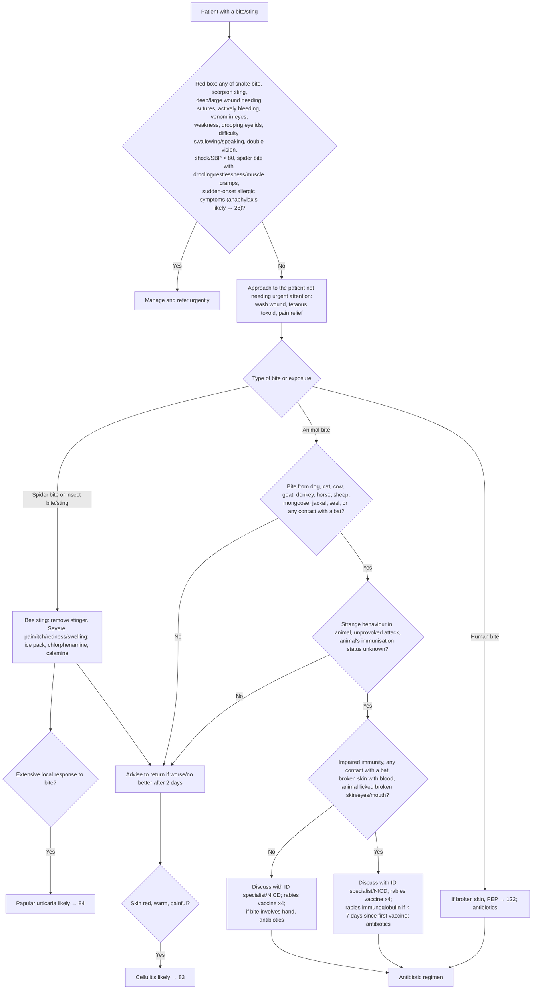

# Page 29 – Bites and stings: flowchart

Source: APC 2026 e-book, page 29 (`inputs/2026/p29.png`). The red box is a list ("Give urgent
attention to the patient with a bite/sting and any of: …"); below it, "Approach to the patient
with a bite/sting not needing urgent attention" splits by type of bite.

## Decision nodes → rules

| Node | Modelled as | Rule |
|---|---|---|
| Patient with a bite/sting | `Bite - wound` (covers snake, spider, animal, human and insect bite wounds as descendants), `Insect bite - wound` (the recorded common symptom) or `Insect sting` | due_to of `Check for urgent bite and sting conditions` |
| Red box, anaphylaxis item | Bite/sting **and** sudden onset of any of the listed symptoms | `Diagnose probable anaphylaxis after a bite or sting` |
| Red box (all items) | `(and bite/sting (or …red box items…, (active_condition Anaphylaxis)))` | `Urgent: bite or sting with danger signs` |
| Spider bite or insect bite/sting → extensive local response | `Insect bite reaction` with the `Extensive` qualifier (itself a kind of insect bite wound; SNOMED has no spider or sting equivalent) | `Diagnose probable papular urticaria after a bite or sting` |
| Return box → skin red, warm, painful | Bite/sting **and** erythema **and** warm skin **and** pain of skin | `Diagnose probable cellulitis after a bite or sting` |
| Animal bite questions (A1–A3), human bite | Not modelled: these route to rabies vaccine, immunoglobulin, PEP and antibiotics (management only); no diagnosis is named | — |

## Notes

- The red box's "Manage and refer urgently" list and the whole non-urgent approach are management
  and are not modelled (no `manage` tasks in this pass).
- The cellulitis box is reached from the spider/insect branch and the two low-risk animal-bite "No"
  branches. The rule applies it to any bite/sting, because the language cannot cleanly express the
  animal-bite routing; see the remaining-questions file.
