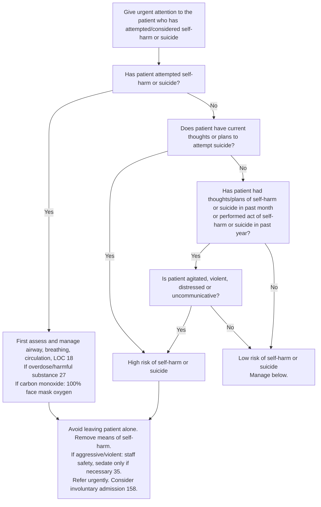

# Page 34 – Self-harm or suicide: flowchart

Source: `inputs/2026/p34.png` (red box, one flowchart).

## Decision nodes → rules

| Node | Modelled as | Rule |
|---|---|---|
| Header (presenting complaint) | Suicide attempt, intentional self-harm, suicidal thoughts or thoughts of self-harm recorded | `Check for self-harm or suicide risk` (trigger) |
| Q1 = Yes | `Suicide attempt` (event) or `Intentionally harming self` (event) | `Urgent: attempted self-harm or suicide` |
| Q2 = Yes | `Suicidal thoughts` or `Planning suicide`, each with qualifier `Current` | `Diagnose probable high risk of self-harm or suicide`, first branch |
| Q3 = Yes → Q4 = Yes | (onset of suicidal thoughts / thoughts of self-harm / planning suicide within 1 month, or onset of a past suicide attempt / self-harm act within 1 year) **and** any of feeling agitated, aggressive behaviour, distress, does not communicate | `Diagnose probable high risk of self-harm or suicide`, second branch |
| High risk | `(active_condition High suicide risk)` | `Urgent: high risk of self-harm or suicide` |
| Q3 = No / Q4 = No → Low risk | Not modelled as a rule (routing to "Manage below"; low risk carries no triage priority) | — |
| Management boxes | Management steps, not modelled (no `manage` tasks in this pass) | — |
