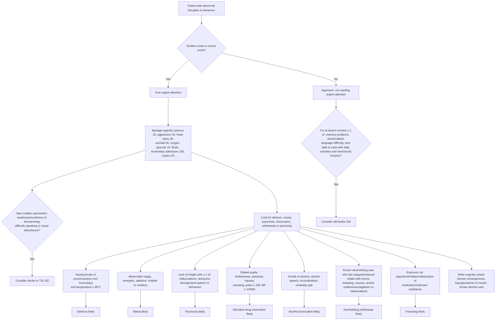

# Page 36 – Abnormal thoughts or behaviour: flowchart

Source: `inputs/2026/p36.png` (one red box, with seven "look for" boxes each joined to a "likely" box).

## Decision nodes → rules

| Node | Modelled as | Rule |
|---|---|---|
| Complaint | Abnormal behavior **or** Disturbance in thinking | trigger of `Check for urgent abnormal thoughts or behaviour conditions`; first conjunct of every rule below |
| RB = Yes | complaint with Sudden onset **or** Recent qualifier | `Urgent: abnormal thoughts or behaviour of sudden or recent onset` |
| ST = Yes | any sudden-onset weakness/numbness of face, upper limb, lower limb, difficulty talking, visual disturbance | `Diagnose possible stroke in abnormal thoughts or behaviour`, `Diagnose possible TIA in abnormal thoughts or behaviour` |
| B1 → D1 | Fluctuation of level of consciousness **and** temperature ≥ 38 °C | `Diagnose probable delirium in abnormal thoughts or behaviour` |
| B2 → D2 | any of Elevated mood, Increased energy, Pressure of speech, Feeling irritable (reckless: no concept) | `Diagnose probable mania in abnormal thoughts or behaviour` |
| B3 → D3 | Lack of insight **and** any of Hallucinations, Delusion, Incoherent speech | `Diagnose probable psychosis in abnormal thoughts or behaviour` |
| B4 → D4 | any of dilated pupil, restlessness, paranoid ideation, nausea, sweating, pulse ≥ 100, systolic ≥ 140, diastolic ≥ 90 | `Diagnose probable stimulant drug intoxication in abnormal thoughts or behaviour` |
| B5 → D5 | any of smell of alcohol on breath, slurred speech, incoordination, unsteady when walking | `Diagnose probable alcohol intoxication in abnormal thoughts or behaviour` |
| B6 → D6 | (stopped drinking / decreased alcohol consumption / abstinent from drug misuse) **and** any of tremor, sweating, nausea, severe restlessness, severe agitation, hallucinations | `Diagnose probable alcohol/drug withdrawal in abnormal thoughts or behaviour` |
| B7 → D7 | exposure to Drug or medicament **or** to Substance (unknown) | `Diagnose probable poisoning in abnormal thoughts or behaviour` |
| DM = Yes | onset ≥ 6 months ago of any of memory impairment, disorientated, language difficulty, difficulty coping | `Diagnose possible dementia in abnormal thoughts or behaviour` |
| Manage urgently / Refer urgently unless | management and cross-references only | not encoded (`management_step` / `cross_reference_only`) |
