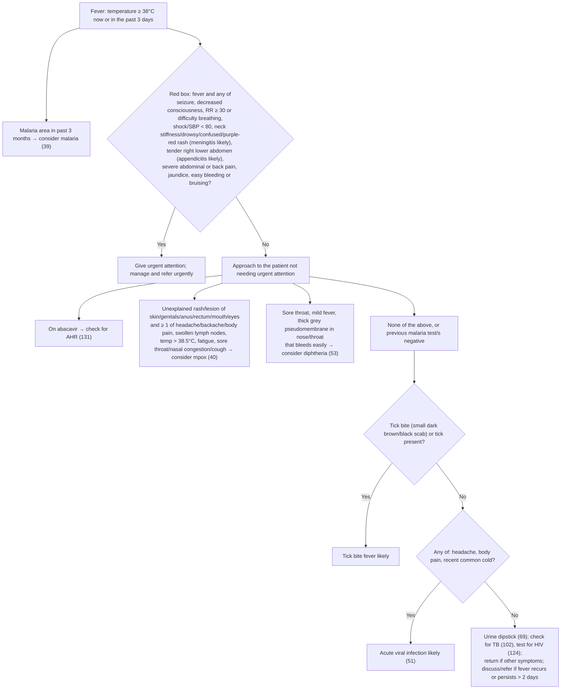

# Page 38 – Fever: flowchart

Source: `inputs/2026/p38.png` (APC 2026, page 38). Red box at the top; "Approach to the patient
with a fever not needing urgent attention" below it, ending in a Yes/No tick-bite question.

## Decision nodes → rules

| Node | Modelled as | Rule |
|---|---|---|
| Fever definition | `(or (active_condition Fever) (>= Body temperature 38 °C))`. "In the past 3 days" for a measurement cannot be expressed; only the current temperature is compared | trigger of `Check for urgent fever conditions`, `Check for causes of fever not needing urgent attention` and the fever term of every rule below |
| Malaria area in past 3 months | Not encoded: no SNOMED concept for having been in a malaria area | — (SNOMED gap) |
| Red box = Yes | Fever **and** any red-box item; meningitis and appendicitis items through their probable diagnoses | `Urgent: fever with red-box danger signs` |
| Neck stiffness, drowsy/confused or purple/red rash → meningitis likely | Fever **and** any of stiff neck, drowsy, acute confusion, purpuric rash | `Diagnose probable meningitis from fever page` |
| Tender in right lower abdomen → appendicitis likely | Fever **and** tenderness of right lower quadrant | `Diagnose probable appendicitis from fever page` |
| On abacavir → AHR | Pointer to page 131 only | — (cross-reference) |
| Consider mpox | Fever **and** (rash or lesion at any of the six sites) **and** any of the listed symptoms or temp > 38.5 °C. "Unexplained" not modelled | `Diagnose possible mpox from fever page` |
| Consider diphtheria | Fever **and** sore throat **and** pseudomembrane in nose or throat. "Mild", "thick grey" and "bleeds easily if touched" not modelled | `Diagnose possible diphtheria from fever page` |
| Tick = Yes → tick bite fever likely | Fever **and** (tick bite or tick infestation) | `Diagnose probable tick bite fever` |
| Tick = No → any of headache, body pain, recent common cold → acute viral infection likely | Fever **and** tick bite and tick infestation all recorded No **and** any of headache, generalized aches and pains, recent common cold | `Diagnose probable acute viral infection from fever page` |
| None of above → dipstick, TB, HIV, return/refer | Routing to other pages and advice | — (cross-reference / management) |

## Notes

- "Not needing urgent attention", "none of the above" and "previous malaria test/s negative" are
  sequencing preconditions that are not modelled; the lower rules can fire alongside the red box.
- Management lines in the red box and in the tick-bite-fever box are not modelled (no `manage`
  tasks in this pass).
