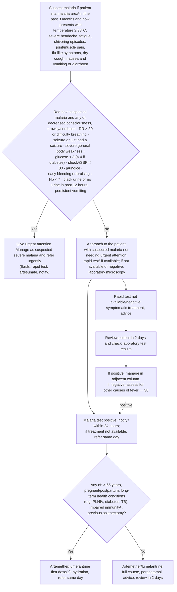

# Page 39 – Malaria: flowchart

Source: APC 2026 e-book, page 39 (page image `inputs/2026/p39.png`).

## Decision nodes → rules

| Node | Modelled as | Rule |
|---|---|---|
| S (what makes us ask) | Any of the page's presenting symptoms that the app records (temperature ≥ 38, headache, fatigue, muscle pain, cough, nausea, vomiting, diarrhoea) → ask about being in a malaria area, and about the symptoms the app does not record by default (severe headache, shivering, joint pain, flu-like illness, dry cough) | `Check for exposure to a malaria area` |
| S = suspect malaria | History of travel with high risk of exposure to communicable disease, onset within the past 3 months, **and** any of the listed symptoms | `Diagnose possible malaria` |
| Suspected malaria → red box questions | `(diagnosis Malaria possible)` triggers the check for the red-box items | `Check for urgent signs in suspected malaria` |
| RB = Yes | Suspected malaria **and** any red-box item (Hb < 7 not representable) | `Urgent: suspected malaria with danger signs` |
| RB = Yes → "Manage as suspected severe malaria" | Same evidence as the priority rule, at `possible` certainty, as Complicated malaria | `Diagnose possible complicated (severe) malaria` |
| Malaria test positive / negative | Laboratory and rapid-test results have no observable in the language | not modelled (see remaining questions) |
| RISK | Routes between two management branches only | not modelled (management) |
| Treatment boxes, review, notify | Management | not modelled (no `manage` tasks) |

## Notes

- "In the past 3 months" is written as `(<= (onset …) (time_ago 3 months))` on the travel
  finding, following the brief's convention that `<=` means "within".
- Footnote 2 ("If systolic BP < 80, pulse ≥ 100, respiratory rate > 30, confusion/restlessness,
  weakness, shock likely") is not turned into a shock diagnosis rule; per the shared decision on
  shock, only the red box's own "Shock/systolic BP < 80" is encoded.
