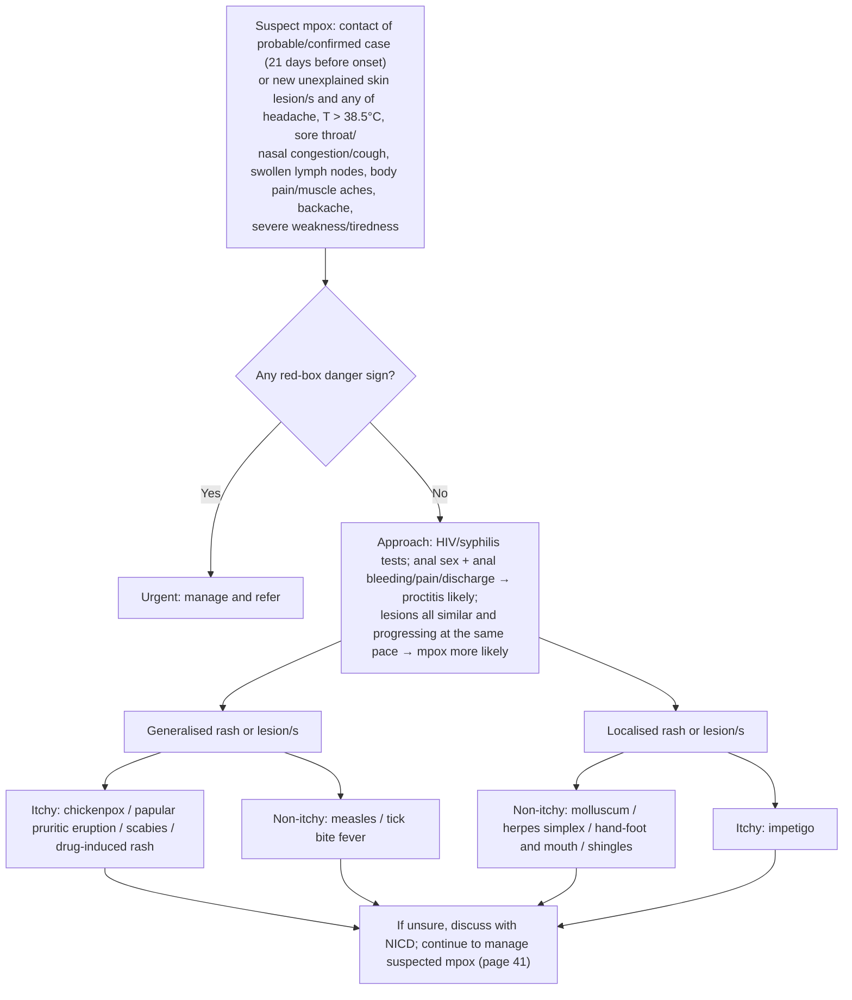

# Page 40 – Mpox: diagnosis and management: flowchart

Source: `inputs/2026/p40.png`. The page has no Yes/No chart, but the lower half is a decision tree
(urgent or not → distribution of rash → itchy or not → "X likely").

## Decision nodes → rules

| Node | Modelled as | Rule |
|---|---|---|
| Suspect mpox | Exposure to monkeypox virus, or New skin lesion and any listed symptom | `Diagnose possible mpox` → triggers both check_for tasks |
| Red box | `(and (active_condition Monkeypox possible) (or …))` | `Urgent: suspected mpox with danger signs`, with `Diagnose probable dehydration/paraphimosis/myocarditis/corneal infection in suspected mpox` |
| Severe anal bleeding/pain/discharge; anal sex + anal symptoms | two branches of one rule | `Diagnose probable proctitis in suspected mpox` |
| Mpox more likely (lesions similar, same pace) | not encoded (no SNOMED concept) | – |
| Generalised, itchy | Generalized rash + Itching of skin + … | `Diagnose probable chickenpox / papular pruritic eruption / scabies / drug-induced rash in suspected mpox` |
| Generalised, non-itchy | Generalized rash + (no Itching of skin) + … | `Diagnose probable measles / tick bite fever in suspected mpox` |
| Localised, non-itchy | Localized eruption of skin + (no Itching of skin) + … | `Diagnose probable molluscum contagiosum / herpes simplex / hand-foot and mouth disease / shingles in suspected mpox` |
| Localised, itchy | Localized eruption of skin + Itching of skin + Crust on skin | `Diagnose probable impetigo in suspected mpox` |
| NICD / page 41 | routing only | – |
