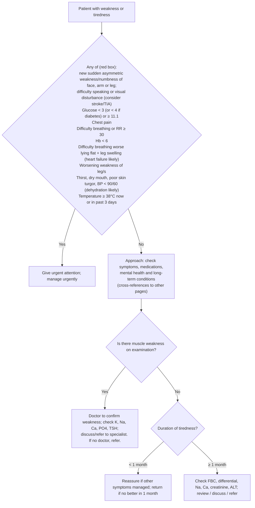

# Page 43 – Weakness or tiredness: flowchart

Source: `inputs/2026/p43.png` (APC 2026, page 43). The red box is a screen applied to every patient
with weakness or tiredness; the lower half is the approach for the patient not needing urgent
attention.

## Decision nodes → rules

| Node | Modelled as | Rule |
|---|---|---|
| Patient with weakness or tiredness | `Fatigue` (common symptom) or `Asthenia` (finding) | trigger of `Check for urgent weakness or tiredness conditions`; first conjunct of every rule below |
| RB: stroke/TIA signs | Sudden-onset weakness or numbness of face, upper limb or lower limb; difficulty talking; visual disturbance | `Possible stroke in weakness or tiredness`, `Possible TIA in weakness or tiredness`, and a branch of `Urgent: weakness or tiredness with danger signs` |
| RB: glucose | Glucose < 3, or < 4 with known diabetes, or ≥ 11.1 mmol/L | branch of `Urgent: weakness or tiredness with danger signs` |
| RB: chest pain | Chest pain | branch of `Urgent: weakness or tiredness with danger signs` |
| RB: difficulty breathing or RR ≥ 30 | Difficulty breathing, or respiratory rate ≥ 30 | branch of `Urgent: weakness or tiredness with danger signs` |
| RB: Hb < 6 | Not representable (no haemoglobin observable/unit) | none (see remaining questions) |
| RB: heart failure likely | Orthopnea **and** leg swelling | `Probable heart failure in weakness or tiredness` → `(active_condition Heart failure)` in the priority rule |
| RB: worsening weakness of leg/s | Weakness of muscle of lower limb, qualified Worsening | branch of `Urgent: weakness or tiredness with danger signs` |
| RB: dehydration likely | Any of thirst, dry mouth, decreased skin turgor, SBP < 90 or DBP < 60 | `Probable dehydration in weakness or tiredness` → `(active_condition Dehydration)` in the priority rule |
| RB: temperature | Temperature ≥ 38 °C, or Fever recorded | branch of `Urgent: weakness or tiredness with danger signs` |
| Approach boxes (symptoms, medications, mental health, long-term conditions) | Cross-references and tests (TSH, Hb, HIV) to other pages; not modelled | none |
| Muscle weakness on examination? Yes/No; duration < 1 month / ≥ 1 month | Routing to management/investigation only; no diagnosis or priority results from it | none |
