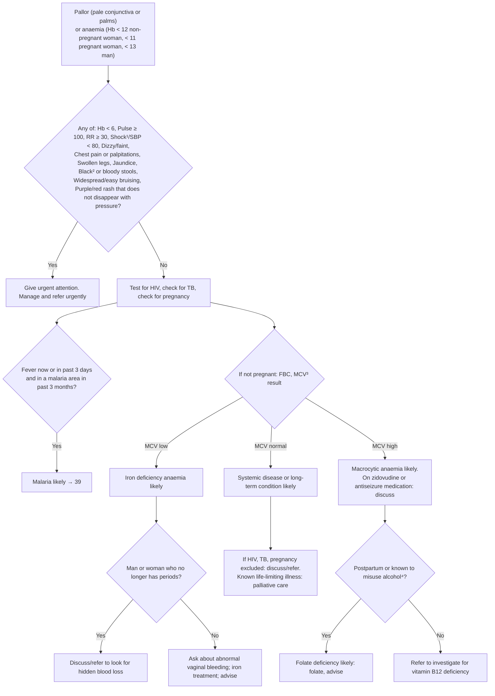

# Page 44 – Pallor and anaemia: flowchart

Source: `inputs/2026/p44.png` (APC 2026, page 44), red box and the "Approach to the patient with
pallor/anaemia not needing urgent attention" algorithm below it.

¹ If SBP < 80, pulse ≥ 100, respiratory rate > 30, confusion/restlessness, weakness, shock likely.
² Black stools may be caused by iron tablets. ³ MCV low/normal/high against the FBC reference range.
⁴ > 14 drinks/week or ≥ 4 drinks/session.

## Decision nodes → rules

| Node | Modelled as | Rule |
|---|---|---|
| P (presenting complaint) | `or` of Pale conjunctiva, Pale complexion, Pale discoloration of entire skin of body (SNOMED synonym "Pallor"), Anemia — as `clinical_finding` | trigger of `Check for urgent pallor/anaemia conditions` and of `Urgent: pallor/anaemia with danger signs` |
| RB = Yes | P **and** `or` of every red-box item except Hb < 6 | `Urgent: pallor/anaemia with danger signs` (items checked by `Check for urgent pallor/anaemia conditions`) |
| RB = No → Approach | Not modelled (HIV/TB/pregnancy checks are pointers to other pages) | — |
| MAL = Yes | P **and** active Fever **and** history of high-risk travel with onset within 3 months | `Diagnose probable malaria in pallor/anaemia` (travel checked by `Check for malaria exposure in pallor/anaemia`) |
| FBC / MCV low / normal / high | Not representable: no MCV or Hb observable in the language | — |
| Iron deficiency / systemic disease / macrocytic / folate deficiency likely | Not representable: every branch hangs on the MCV result | — (see remaining questions) |
| MEN, PP, HID, B12 | Depend on the MCV branch; management/referral only | — |

## Notes

- "Hb < 6" (red box) and the Hb thresholds that define anaemia cannot be expressed; anaemia is
  taken from a recorded `Anemia` finding.
- "Shock¹/SBP < 80" is encoded exactly as an `or` of the Shock finding and systolic BP < 80; the
  footnote's own definition of shock is not built.
- "Not needing urgent attention" is not encoded as a negation: the malaria rule fires whether or
  not the urgent rule also fires.
