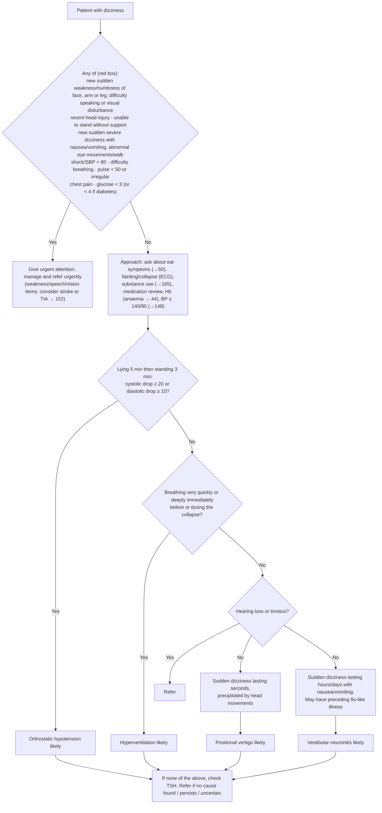

# Page 46 – Dizziness: flowchart

Source: `inputs/2026/p46.png` (APC 2026 e-book, page 46). Red box first, then the
"Approach to the patient with dizziness not needing urgent attention" algorithm.

## Decision nodes → rules

| Node | Modelled as | Rule |
|---|---|---|
| Presenting complaint | `(clinical_finding Dizziness)` (a recorded common symptom) | trigger of `Check for urgent dizziness conditions`, `Check for causes of dizziness not needing urgent attention`, `Measure lying and standing BP for dizziness` |
| RB = Yes | `(and Dizziness (or …red-box items…))`; shock/SBP < 80 as `(or Shock (< SBP 80))`; glucose as `(or (< glucose 3) (and known diabetes (< glucose 4)))` | `Urgent: dizziness with danger signs` |
| "consider stroke or TIA" | `possible` diagnoses from the sudden weakness/numbness/speech/vision items | `Diagnose possible stroke in dizziness`, `Diagnose possible TIA in dizziness` |
| OH (postural BP drop) | **Not modelled**: the language cannot compare two measurements (a drop). Lying and standing BP are requested by a `measure` task only | `Measure lying and standing BP for dizziness` (no diagnosis rule) |
| HV = Yes | Tachypnoea or deep breathing | `Diagnose probable hyperventilation in dizziness` |
| EAR = Yes | Hearing loss or tinnitus → Refer (management; no rule). Used as `(no …)` in the two branches below | — |
| EAR = No → SEC | Sudden-onset positional vertigo, no hearing loss/tinnitus, no tachypnoea/deep breathing | `Diagnose probable positional vertigo` |
| EAR = No → HRS | Sudden-onset dizziness with nausea or vomiting, no hearing loss/tinnitus, no tachypnoea/deep breathing | `Diagnose probable vestibular neuronitis` |
| Approach bullets, TSH, Refer | management / cross-references; not modelled | — |

## Notes

- The "No" branch of the orthostatic question cannot be expressed, so the hyperventilation,
  positional vertigo and vestibular neuronitis rules do not require "no postural BP drop".
- "Lasting seconds" vs "lasting hours/days" is an episode duration; the language has onset
  comparisons only, so duration is not modelled.
