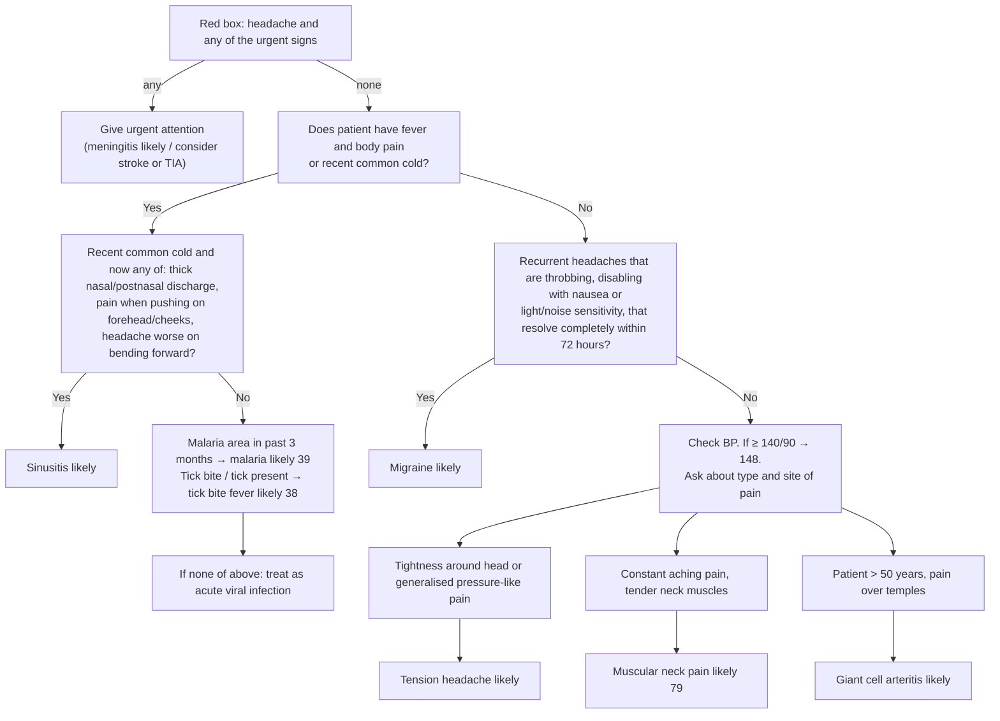

# Page 47 – Headache: flowchart

Source: `inputs/2026/p47.png` (APC 2026, page 47). The red box is a flat list (no branches); the
lower half of the page is the algorithm "Approach to the patient with headache not needing urgent
attention".

## Decision nodes → rules

| Node | Modelled as | Rule |
|---|---|---|
| Red box (presenting complaint + any item) | `(and Headache (or …each red-box item…))` | `Check for urgent headache danger signs`, `Urgent: headache with danger signs (APC p47)` |
| Red box: neck stiffness, drowsy/confused, purple/red rash → meningitis likely | Headache **and** any of stiff neck, drowsy, clouded consciousness, acute confusion, purpuric rash | `Diagnose probable meningitis in patient with headache` |
| Red box: new sudden asymmetric weakness/numbness; difficulty speaking → consider stroke or TIA | Headache **and** any sudden-onset weakness/numbness of face, arm, leg, or sudden-onset difficulty talking | `Diagnose possible stroke in patient with headache`, `Diagnose possible TIA in patient with headache` |
| Red box: fever now / past 3 days and malaria area → malaria likely | Not encoded: no SNOMED concept for "in a malaria area" | — (see remaining questions) |
| Q0 = Yes | `(or (and (active_condition Fever) Generalized aches and pains) (Common cold + Recent))` | Used inside the tick-bite-fever and acute-viral-infection rules |
| Q1 = Yes | Recent common cold **and** any of thick nasal discharge, thick posterior rhinorrhea, tenderness over forehead, tenderness over cheek ("worse on bending forward" has no concept) | `Diagnose probable sinusitis in patient with headache` |
| Q1 = No → tick bite | Q0 **and** tick bite | `Diagnose probable tick bite fever in patient with headache` |
| Q1 = No → malaria area | Not encoded (SNOMED gap) | — |
| "If none of above" → acute viral infection | Q0 **and not** an active sinusitis, tick bite fever or malaria | `Diagnose possible acute viral infection in patient with headache` |
| Q2 = Yes | Recurrent throbbing headache **and** any of nausea, photophobia, phonophobia ("disabling" and "resolve within 72 hours" not modelled) | `Diagnose probable migraine in patient with headache` |
| Q2 = No → tightness / generalised pressure-like pain | Tightening pain at head structure, or generalized headache | `Diagnose probable tension headache in patient with headache` |
| Q2 = No → constant aching pain, tender neck muscles | Continuous aching pain **and** tenderness of neck skeletal muscle | `Diagnose probable muscular neck pain in patient with headache` |
| Q2 = No → > 50 years, pain over temples | Temporal headache (age not representable) | `Diagnose probable giant cell arteritis in patient with headache` |
| Check BP, if ≥ 140/90 → 148 | Cross-reference only (BP is a routine vital) | — |

## Notes

- Following the gold standard, downstream nodes do not require the upstream "No" answers (e.g.
  migraine does not require "no fever and body pain"); each "likely" node is encoded from its own
  criteria. The exception is "If none of above", whose meaning is the negation, encoded with `not`.
- BP ≥ 140/90 and ≥ 180/110 are read as systolic ≥ X **or** diastolic ≥ Y.
