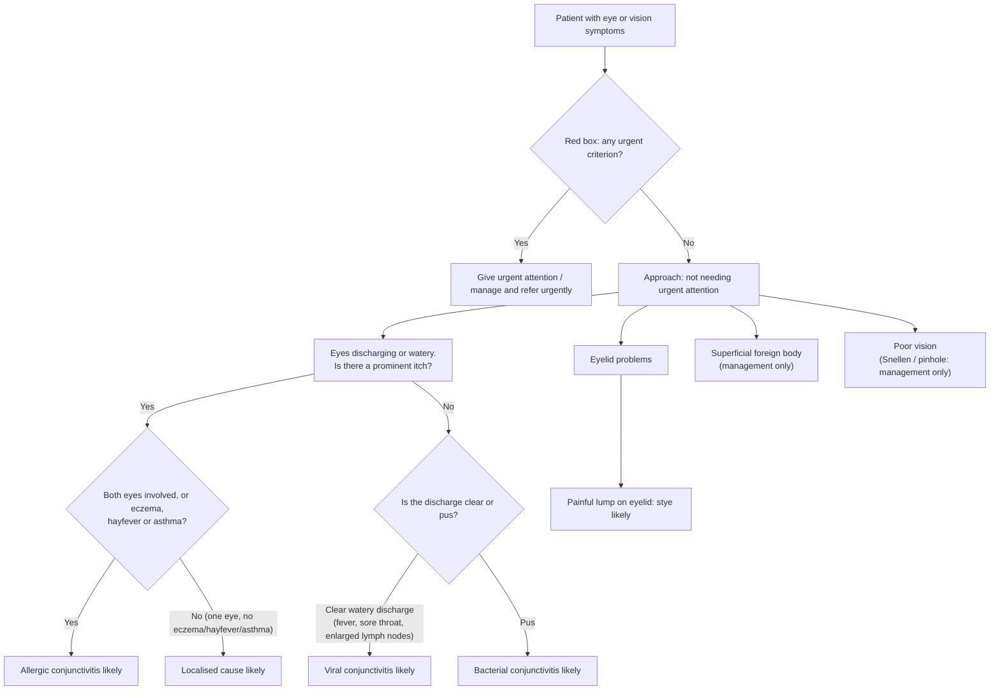

# Page 48 – Eye/vision symptoms: flowchart

Source: `inputs/2026/p48.png` (APC 2026, page 48). Red box at top; "Approach to patient with
eye/vision symptoms not needing urgent attention" below it.

## Decision nodes → rules

| Node | Modelled as | Rule |
|---|---|---|
| Red box criteria | `(and (Eye / vision finding) (or …))` with every red-box item | `Check for urgent eye/vision conditions`; `Urgent: eye/vision symptoms with danger signs` |
| Stroke or TIA likely | New sudden asymmetric face/limb weakness or numbness; new sudden difficulty talking or visual disturbance | `Diagnose probable stroke from eye/vision symptoms` |
| Gonococcal conjunctivitis likely | Sudden red eye **and** excessive eye discharge **and** recent STI | `Diagnose probable gonococcal conjunctivitis` |
| Orbital cellulitis likely | Eyelid swollen **and** red **and** painful | `Diagnose probable orbital cellulitis` |
| Acute glaucoma likely ("Manage and refer urgently") | Painful eye **and** red eye **and** any of blurred vision, haloes, fixed dilated pupil, headache, nausea, vomiting | `Diagnose probable acute angle closure from eye symptoms` |
| Yellow eyes: jaundice likely | Scleral icterus | `Diagnose probable jaundice from yellow eyes` |
| Itch = Yes and (both eyes, or eczema/hayfever/asthma) | Discharge/watery eye **and** itching of eye **and** (bilateral discharge/watery eye or eczema or hayfever or asthma) | `Diagnose probable allergic conjunctivitis` |
| Itch = Yes, one eye, none of eczema/hayfever/asthma → localised cause | Not modelled: "localised cause" is not a diagnosis concept | — |
| Itch = No → clear watery discharge | No itching of eye **and** serous conjunctival discharge | `Diagnose probable viral conjunctivitis` |
| Itch = No → pus | No itching of eye **and** purulent conjunctival discharge | `Diagnose probable bacterial conjunctivitis` |
| Painful lump on eyelid → stye likely | Mass on eyelid **and** pain of eyelid | `Diagnose probable stye` |
| Superficial foreign body, poor vision, itchy/swollen eyelids, discuss/refer | Management and referral steps | not modelled (no `manage` tasks) |
