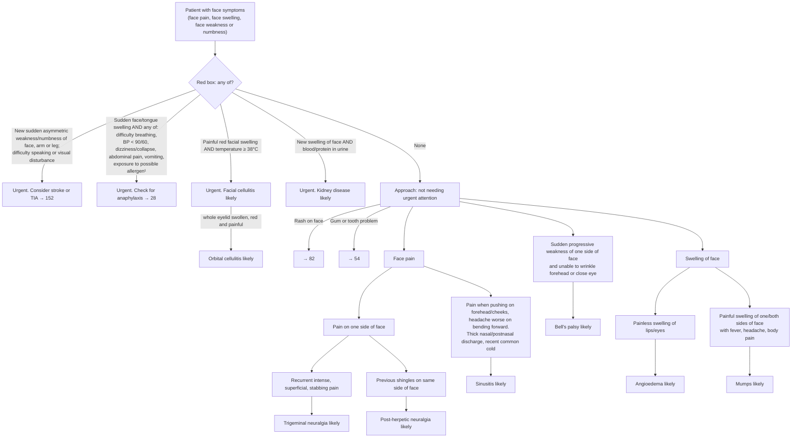

# Page 49 – Face symptoms: flowchart

Source: APC 2026 e-book page 49 (`inputs/2026/p49.png`): the red box, then "Approach to patient with
face symptoms not needing urgent attention".

¹ Common allergens include medication, food or insect bite/sting within the past few hours.

## Decision nodes → rules

| Node | Modelled as | Rule |
|---|---|---|
| Face symptoms (entry) | `or` of Pain in face, Swelling at Face structure, Weakness of face muscles, Numbness of face | trigger of `Check for face symptom conditions`; first `and` arm of `Urgent: face symptoms with red-box signs` |
| Stroke/TIA bullet | Sudden-onset unilateral weakness or numbness of face or limb, sudden difficulty talking, sudden visual disturbance | `Diagnose possible stroke from face symptoms`, `Diagnose possible TIA from face symptoms`; stroke branch of the Urgent rule |
| Anaphylaxis bullet | Sudden face or tongue swelling **and** any of difficulty breathing, SBP < 90, DBP < 60, dizziness, collapse, abdominal pain, vomiting, exposure to drug or food, insect bite/sting | `Diagnose possible anaphylaxis from face swelling`; anaphylaxis branch of the Urgent rule |
| Facial cellulitis bullet | Facial swelling **and** pain in face **and** redness of skin of face **and** temperature ≥ 38 °C | `Diagnose probable facial cellulitis`; `(active_condition Cellulitis of face)` in the Urgent rule |
| Orbital cellulitis | Facial cellulitis evidence **and** eyelid swelling, eyelid erythema, eyelid pain | `Diagnose probable orbital cellulitis from facial cellulitis` |
| Kidney disease bullet | New facial swelling **and** (blood in urine **or** proteinuria) | `Diagnose probable kidney disease from facial swelling`; `(active_condition Kidney disease)` in the Urgent rule |
| Rash on face → 82, gum/tooth → 54 | Cross-references only | not encoded |
| Trigeminal neuralgia | Unilateral pain in face **and** recurrent severe stabbing pain at the face | `Diagnose probable trigeminal neuralgia` |
| Post-herpetic neuralgia | Unilateral pain in face **and** history of herpes zoster | `Diagnose probable post-herpetic neuralgia (face)` |
| Sinusitis | Pain in face **and** tenderness of face **and** any of headache, nasal discharge, posterior rhinorrhoea, common cold | `Diagnose probable sinusitis from face pain` |
| Bell's palsy | Sudden unilateral weakness of face muscles **and** (upper facial weakness **or** unable to close eyes) | `Diagnose probable Bell's palsy` |
| Angioedema | (Lip swelling **and no** lip pain) **or** (eyelid swelling **and no** eyelid pain) | `Diagnose probable angioedema from painless lip/eye swelling` |
| Mumps | Facial swelling **and** pain in face **and** fever **and** headache **and** generalised aches and pains | `Diagnose probable mumps from painful face swelling` |

## Notes

- The red-box bullets are joined by "any of", so each is one branch of a single Urgent `or`.
- "Manage and refer urgently" bullet 2 (pulse > 100 / RR > 30 / BP > 150/100 with kidney disease) is
  treatment selection only (oxygen, furosemide, amlodipine) and is not encoded.
- Everything below each "likely" box (medicines, referral criteria, the antibiotic criteria for
  sinusitis) is management and is not encoded.
