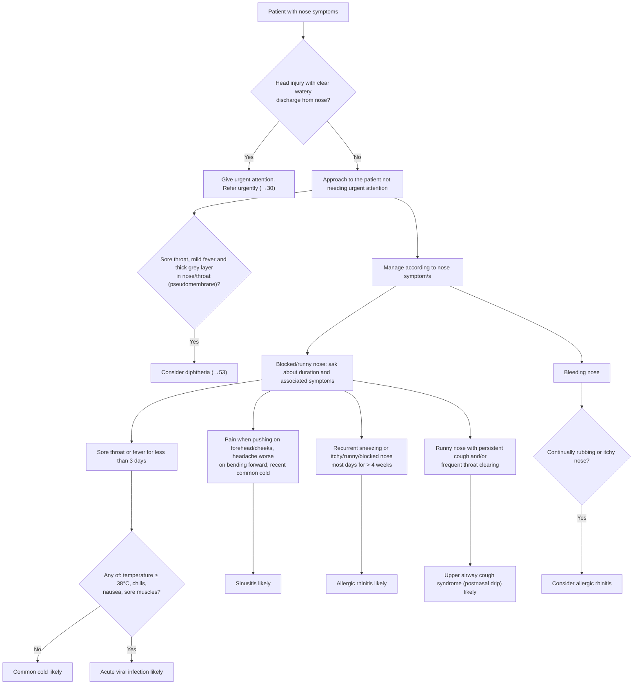

# Page 51 – Nose symptoms: flowchart

Source: `inputs/2026/p51.png` (APC 2026, page 51).

## Decision nodes → rules

| Node | Modelled as | Rule |
|---|---|---|
| Nose symptoms (entry) | `or` of Nasal discharge, Nasal congestion, Bleeding from nose | due_to of `Check for urgent nose symptom conditions` and `Check for causes of nose symptoms` |
| Red box: head injury with clear watery discharge | Injury of head **and** Nasal discharge qualified Clear + Watery | `Urgent: nose symptoms with head injury and clear watery nasal discharge` |
| Consider diphtheria | Sore throat **and** Fever (Mild) **and** Pseudomembrane in nose or pharynx | `Diagnose possible diphtheria from nose symptoms` |
| < 3 days, AQ = No | Blocked/runny nose **and** sore throat or fever with onset within 3 days **and** temperature < 38 and no chill, nausea, muscle pain | `Diagnose probable common cold from nose symptoms` |
| < 3 days, AQ = Yes | Same first two parts **and** any of temperature ≥ 38, chill, nausea, muscle pain | `Diagnose probable acute viral infection from nose symptoms` |
| Sinusitis likely | Blocked/runny nose **and** frontal or maxillary sinus tenderness **and** headache **and** recent common cold | `Diagnose probable sinusitis from nose symptoms` |
| Allergic rhinitis likely | Any of recurrent sneezing / itchy nose / runny nose / blocked nose with onset at least 4 weeks ago | `Diagnose probable allergic rhinitis from nose symptoms` |
| Upper airway cough syndrome likely | Nasal discharge **and** (persistent cough **or** frequent throat clearing) | `Diagnose probable postnasal drip from nose symptoms` |
| Bleeding nose → consider allergic rhinitis | Bleeding from nose **and** (repetitive rubbing of nose **or** itchy nose) | `Diagnose possible allergic rhinitis from nosebleed` |

## Notes

- The flowchart under "Blocked/runny nose" has four parallel columns with no Yes/No between them; each is
  modelled as its own diagnosis rule.
- Everything inside the "likely" boxes (medicines, referral, checks of BP and throat, follow-up) is
  management and is not modelled.
