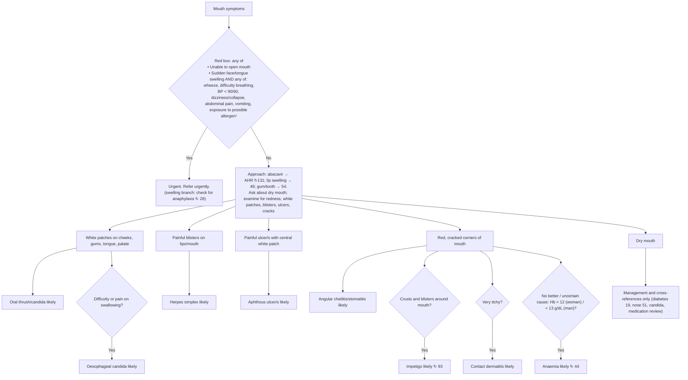

# Page 52 – Mouth symptoms: flowchart

Source: `inputs/2026/p52.png` (APC 2026 e-book, page 52). The page is a red box followed by a
column layout: "Approach to the patient with mouth symptoms not needing urgent attention", then one
column per examination finding, each ending in an "X likely" heading.

¹ Common allergens include medication, food or insect bite/sting within the past few hours.

## Decision nodes → rules

| Node | Modelled as | Rule |
|---|---|---|
| Mouth symptoms (presenting complaint) | `(clinical_finding Mouth symptoms)` as task trigger | `Check for urgent mouth symptom conditions`, `Check for causes of mouth symptoms` |
| Red box, bullet 1 | Unable to open mouth | `Urgent: mouth symptoms with danger signs` |
| Red box, bullet 2 | Sudden-onset face or tongue swelling AND any of wheeze, difficulty breathing, SBP < 90, DBP < 60, dizziness, collapse, abdominal pain, vomiting, exposure to drug/food, insect bite/sting | `Urgent: mouth symptoms with danger signs`; also `Mouth symptoms: possible anaphylaxis` (the "check for anaphylaxis" pointer) |
| White patches → oral thrush/candida likely | White patches on oral mucosa | `Diagnose probable oral candidiasis (mouth symptoms)` |
| White patches + difficulty/pain on swallowing → oesophageal candida likely | White patches AND (difficulty swallowing OR swallowing painful) | `Diagnose probable oesophageal candidiasis (mouth symptoms)` |
| Painful blisters on lips/mouth → herpes simplex likely | Blister on lip or in oral cavity | `Diagnose probable herpes simplex (mouth symptoms)` |
| Painful ulcer/s with central white patch → aphthous ulcer/s likely | Ulcer of mouth | `Diagnose probable aphthous ulcer (mouth symptoms)` |
| Red, cracked corners → angular cheilitis likely | Fissure at angle of mouth | `Diagnose probable angular cheilitis (mouth symptoms)` |
| + crusts and blisters around mouth → impetigo likely | Fissure at angle of mouth AND crust AND blister on perioral skin | `Diagnose probable impetigo (mouth symptoms)` |
| + very itchy → contact dermatitis likely | Fissure at angle of mouth AND severe itching at angle of mouth | `Diagnose probable contact dermatitis (mouth symptoms)` |
| Hb low → anaemia likely | Not modelled (Hb has no unit in the language) | none |
| Dry mouth column | Management and pointers only | none |
