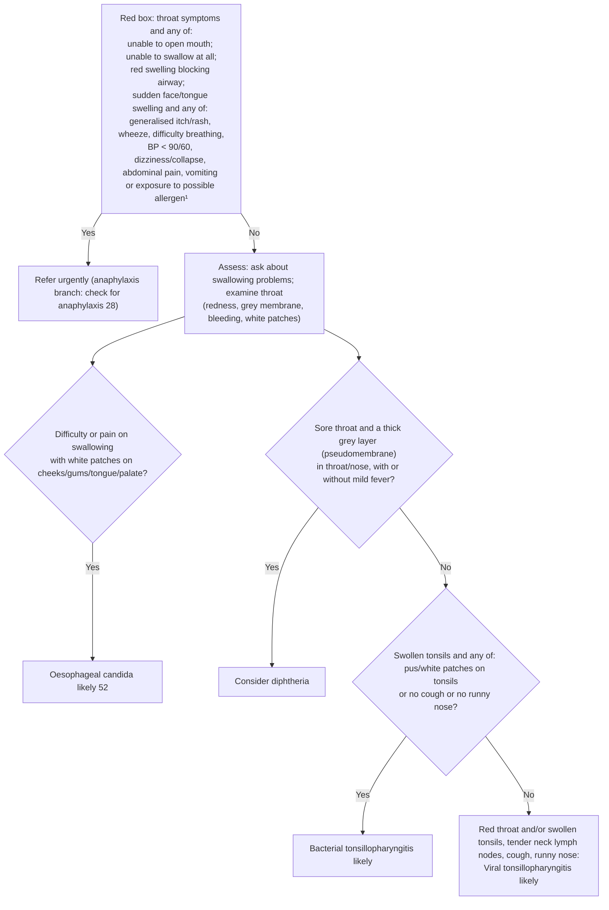

# Page 53 – Throat symptoms: flowchart

Source: APC 2026 e-book, page 53 (`inputs/2026/p53.png`).

¹ Common allergens include medication, food or insect bite/sting within the past few hours.

## Decision nodes → rules

| Node | Modelled as | Rule |
|---|---|---|
| Red box | Sore throat **and** any of: unable to open mouth, unable to swallow, pharyngeal swelling **with** upper respiratory tract obstruction, or sudden face/tongue swelling **with** any of the listed anaphylaxis features | `Check for urgent throat symptom conditions` (check_for), `Urgent: throat symptoms with danger signs` |
| Red box, anaphylaxis bullet ("check for anaphylaxis 28") | Same sudden face/tongue swelling combination → `possible` anaphylaxis, which hands over to the anaphylaxis page | `Consider anaphylaxis with throat symptoms` |
| CAND = Yes | (Difficulty swallowing **or** painful swallowing) **and** white patches on oral mucosa | `Diagnose probable oesophageal candidiasis from throat symptoms` |
| Q1 = Yes | Sore throat **and** pseudomembrane in pharynx **or** nose | `Consider diphtheria with sore throat and pseudomembrane` |
| Q1 = No → Q2 = Yes | Sore throat, recorded *no* pseudomembrane (pharynx and nose), tonsil swelling **and** any of: exudate on tonsils, *no* cough, *no* nasal discharge | `Diagnose probable bacterial tonsillopharyngitis` |
| Q1 = No → Q2 = No | Sore throat, recorded *no* pseudomembrane (pharynx and nose), and either (*no* tonsil swelling **and** red throat) or (tonsil swelling **and** *no* exudate **and** cough **and** nasal discharge) | `Diagnose probable viral tonsillopharyngitis` |
| Assessment (examination findings) | check_for of swallowing problems, throat redness, pseudomembrane, tonsil swelling/exudate, white oral patches, cough, nasal discharge | `Assess throat symptoms not needing urgent attention` |

## Notes

- "With or without mild fever" does not change the branch, so fever is not part of the diphtheria rule.
- "Food/liquid gets stuck with swallowing, refer" is a management step (referral), not modelled.
- "Bleeding" in the examination list leads to no decision on this page, so it is not checked for.
