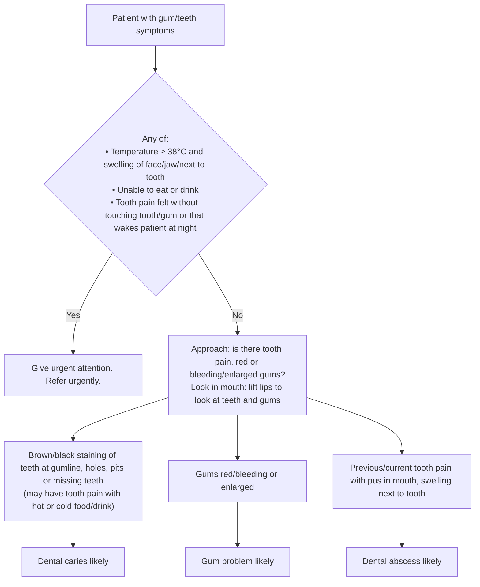

# Page 54 – Gum/teeth symptoms: flowchart

Source: APC 2026 e-book page 54 (`inputs/2026/p54.png`). The page has a red box and, below it, a
three-way "look in mouth" split, each leading to an "X likely" box.

## Decision nodes → rules

| Node | Modelled as | Rule |
|---|---|---|
| Presenting complaint | `Tooth finding` or `Gingivae finding` (descendants match: toothache, bleeding/swollen gums, …) | `Check for urgent gum/teeth conditions` (trigger) |
| RB = Yes | complaint **and** any of: (temperature ≥ 38 °C **and** swelling of face / jaw region / gums); unable to eat; unable to drink; toothache qualified `Spontaneous`; toothache qualified `Night time` | `Urgent: gum/teeth symptoms with fever and swelling, unable to eat/drink or spontaneous/night tooth pain` |
| C1 → Dental caries likely | staining of tooth **or** cavity of tooth **or** tooth loss | `Diagnose probable dental caries (gum/teeth symptoms)` |
| C2 → Gum problem likely | gingival erythema **or** bleeding gums **or** gingival enlargement | `Diagnose probable gum problem (gum/teeth symptoms)` |
| C3 → Dental abscess likely | toothache **and** (pus in mouth **or** swollen gums) | `Diagnose probable dental abscess (gum/teeth symptoms)` |

## Notes

- "May have tooth pain with hot or cold food/drink" is optional supporting detail ("may have"), so
  it is not required evidence for dental caries.
- "Previous" tooth pain is not separately modelled: the toothache finding recorded in the
  encounter stands for previous or current pain.
- Treatment, "refer to dentist if …" and the mouth-care advice are management, not modelled.
