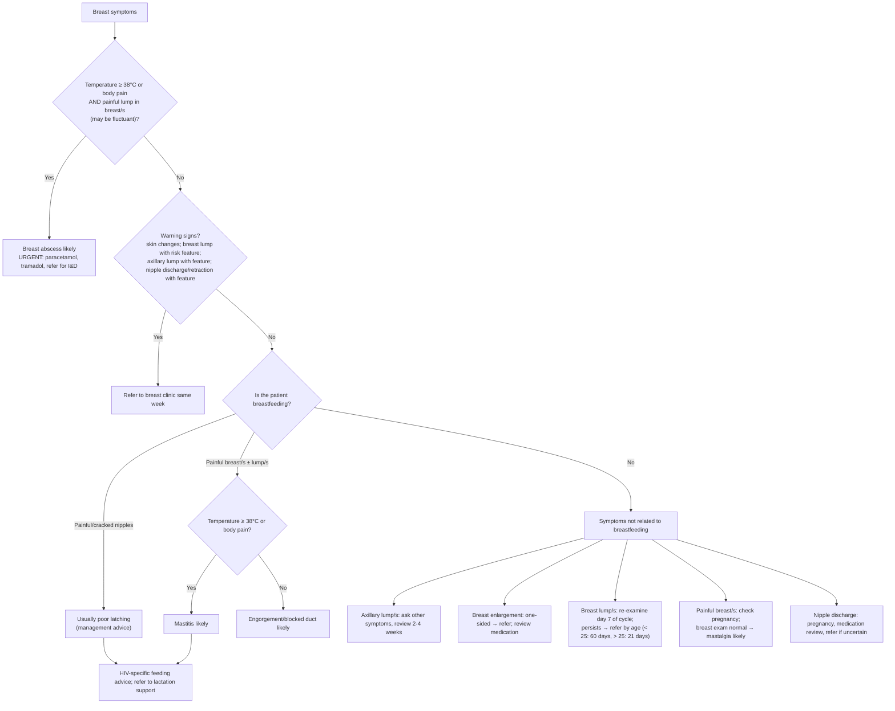

# Page 55 – Breast symptoms: flowchart

## Decision nodes

| Node | Page wording | Rule |
|---|---|---|
| RB | "breast symptoms and temperature ≥ 38°C or body pain with painful lump in breast/s which may be fluctuant: breast abscess likely" | `Diagnose probable breast abscess`; `Urgent: breast symptoms with likely breast abscess`; task `Check for breast symptom conditions` |
| WS | Warning signs → refer same week | Not encoded (referral criteria, no named diagnosis); see remaining questions |
| BF | "Is the patient breastfeeding?" | `Mother currently breastfeeding` in the check_for task |
| T = Yes | "Yes. Mastitis likely" | `Diagnose probable mastitis in a breastfeeding patient` |
| T = No | "No. Engorgement/blocked duct likely" | `Diagnose probable breast engorgement in a breastfeeding patient`; `Diagnose probable blocked milk duct in a breastfeeding patient` |
| NIP | "Usually due to poor latching" | Not encoded (no "likely" diagnosis; management) |
| PB | "If breast exam normal, mastalgia likely" | Not encoded (see Could not model) |
| AX, EN, LU, ND | Management and referral | Not encoded (management) |
