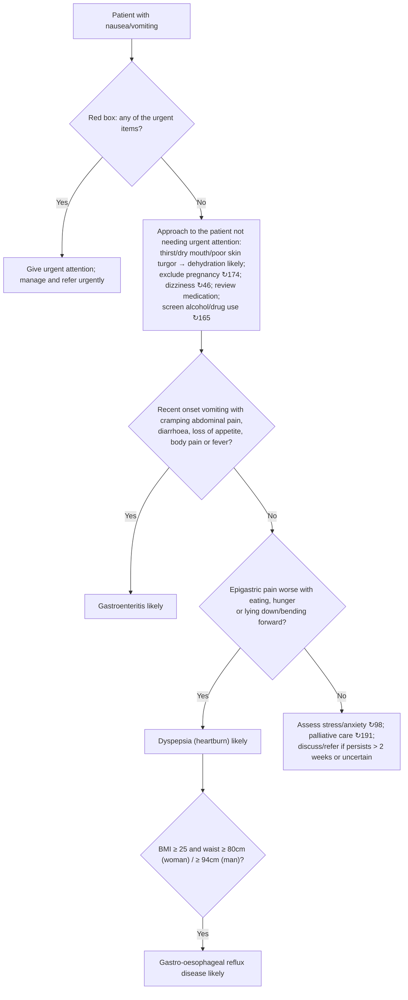

# Page 57 – Nausea/vomiting: flowchart

Source: `inputs/2026/p57.png` (APC 2026, page 57). The red box is a list (any one item makes the
patient urgent); the lower half of the page is a two-question algorithm for the patient not needing
urgent attention.

## Red box items → rules

| Red box item | Modelled as | Rule |
|---|---|---|
| Headache ↗47 | Headache (common symptom) | `Urgent: nausea/vomiting with danger signs` |
| Chest pain ↗24 | Chest pain (warning sign) | `Urgent: nausea/vomiting with danger signs` |
| Watery diarrhoea + cholera outbreak area in past 5 days: cholera likely | Diarrhea + Watery qualifier **and** exposure to *Vibrio cholerae* with onset within 5 days | `Diagnose probable cholera in nausea/vomiting` → `(active_condition Cholera)` in the urgent rule |
| Neck stiffness, drowsy/confused or purple/red rash: meningitis likely | N/V **and** any of stiff neck, drowsy, acute confusion, purpuric rash | `Diagnose probable meningitis in nausea/vomiting` → urgent rule |
| Guarding or rigidity: peritonitis likely | N/V **and** abdominal guarding or rigidity | `Diagnose probable peritonitis in nausea/vomiting` → urgent rule |
| Pain in right lower abdomen: appendicitis likely | N/V **and** right lower quadrant pain | `Diagnose probable appendicitis in nausea/vomiting` → urgent rule |
| Sudden severe upper abdominal pain spreading to back: pancreatitis likely | N/V **and** upper abdominal pain (sudden onset, severe) **and** back pain | `Diagnose probable pancreatitis in nausea/vomiting` → urgent rule |
| Shock/SBP < 80 | Shock **or** systolic BP < 80 | urgent rule |
| Vomiting blood | Hematemesis | urgent rule |
| Jaundice | Jaundice | urgent rule |
| Abdominal pain/distension and no stools or flatus/wind | (abdominal pain or distension) **and** (obstipation, or constipation with "No" recorded for passing flatus) | urgent rule |
| Drowsy/confused/rapid deep breathing | Drowsy, acute confusion, Kussmaul's respiration | urgent rule |
| Sudden N/V and any of …: check for anaphylaxis ↻28 | Sudden-onset nausea or vomiting **and** any of the listed signs/exposures | `Diagnose possible anaphylaxis in nausea/vomiting` and the urgent rule |

## Decision nodes (lower half) → rules

| Node | Modelled as | Rule |
|---|---|---|
| Thirst, dry mouth or poor skin turgor → dehydration likely | N/V **and** any of the three | `Diagnose probable dehydration in nausea/vomiting` |
| Exclude pregnancy ↻174 | N/V | `Diagnose possible pregnancy in nausea/vomiting` |
| Q1 = Yes | Vomiting with "Recent" qualifier **and** any of abdominal colic, diarrhoea, loss of appetite, generalised aches, fever | `Diagnose probable gastroenteritis in nausea/vomiting` |
| Q1 = No → Q2 = Yes | N/V **and** epigastric pain **and** any of pain provoked by eating, hunger pain, pain aggravated by position. The "Q1 = No" precondition is not modelled | `Diagnose probable dyspepsia in nausea/vomiting` |
| Dyspepsia + BMI/waist | Dyspepsia evidence **and** BMI ≥ 25 **and** waist ≥ 80 cm (sex split not representable) | `Diagnose probable GORD in nausea/vomiting with dyspepsia`, with `Measure BMI and waist circumference in dyspepsia` |
| Q2 = No | Stress/anxiety, palliative care, referral | Not modelled (cross-references and management) |

## Notes

- The lower algorithm applies only to patients "not needing urgent attention"; the language cannot
  express "not urgent", so the lower-half rules fire regardless of the red box.
- "Recent onset" and "within the past few hours" (footnote 2) have no defined time span on the page.
