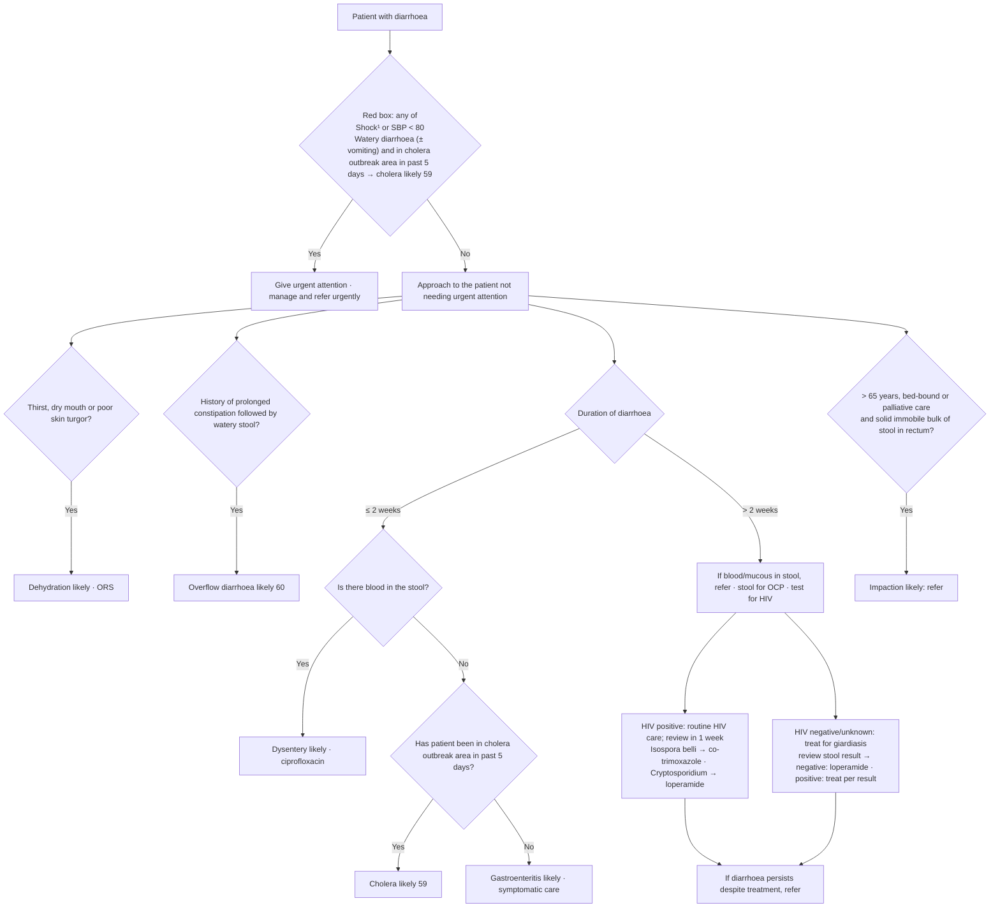

# Page 58 – Diarrhoea: flowchart

Source: `inputs/2026/p58.png` (APC 2026, page 58): red box, "Approach to the patient with diarrhoea
not needing urgent attention", and the duration flowchart below it.

¹ Footnote: "If SBP < 80, pulse ≥ 100, respiratory rate > 30, confusion/restlessness, weakness, shock likely."

## Decision nodes → rules

| Node | Modelled as | Rule |
|---|---|---|
| Presenting complaint | `Diarrhea` (common symptom) triggers the check list | `Check for diarrhoea danger signs and causes` |
| Red box: Shock or SBP < 80 | `Shock` finding **or** systolic BP < 80 | `Urgent: diarrhoea with shock or cholera` |
| Red box: cholera likely | Watery diarrhoea **and** exposure to *Vibrio cholerae* with onset within 5 days → probable cholera, then `(active_condition Cholera)` | `Diagnose probable cholera (diarrhoea page)`, `Urgent: diarrhoea with shock or cholera` |
| Thirst, dry mouth or poor skin turgor | Diarrhoea **and** any of thirst, xerostomia, decreased skin turgor | `Diagnose probable dehydration from diarrhoea` |
| Prolonged constipation followed by watery stool | Chronic constipation **and** watery diarrhoea (sequence not modelled) | `Diagnose probable overflow diarrhoea` |
| ≤ 2 weeks → blood = Yes | Diarrhoea onset within 2 weeks **and** haematochezia | `Diagnose probable dysentery` |
| ≤ 2 weeks → blood = No → cholera area = Yes | Diarrhoea onset within 2 weeks **and** `(no haematochezia)` **and** exposure within 5 days | `Diagnose probable cholera (diarrhoea page)`, second branch |
| ≤ 2 weeks → blood = No → cholera area = No | Diarrhoea onset within 2 weeks **and** `(no haematochezia)` **and** (no exposure **or** exposure at least 5 days ago) | `Diagnose probable gastroenteritis` |
| > 2 weeks branch | Stool tests, HIV test, treatment by HIV status and stool result: management only, no "likely" diagnosis | not modelled (management) |
| Impaction likely | Bed-ridden **and** fullness of rectum due to faeces (age > 65 and palliative care not representable) | `Diagnose probable faecal impaction (diarrhoea page)` |

## Notes

- "≤ 2 weeks" is `(<= (onset Diarrhea) (time_ago 2 weeks))`. "Past 5 days" is `(<= (onset exposure) (time_ago 5 days))`.
- The "> 2 weeks" branch has no "likely" diagnosis; "Treat for giardiasis" is read as a treatment instruction.
