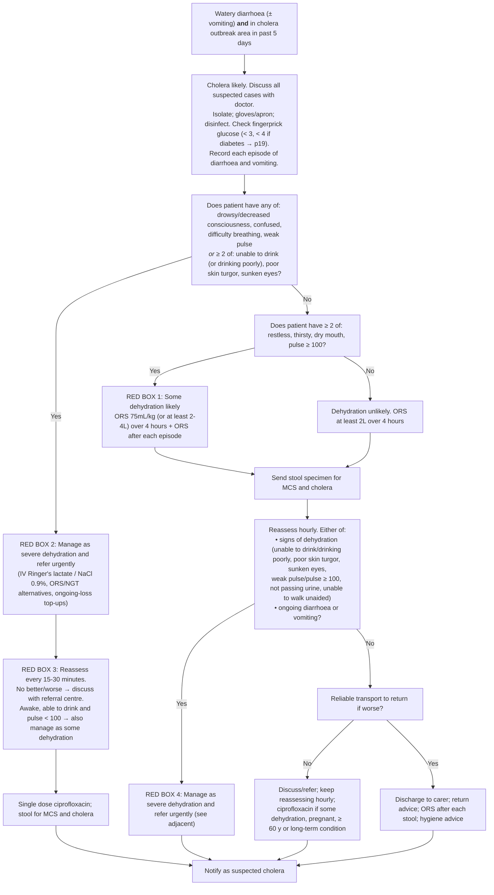

# Page 59 – Cholera: flowchart

Source: `inputs/2026/p59.png` (APC 2026, page 59; four red boxes, all management boxes).

## Decision nodes → rules

| Node | Modelled as | Rule |
|---|---|---|
| Entry (what makes us ask) | Diarrhoea (common symptom) triggers the check for watery diarrhoea and exposure to *Vibrio cholerae* | `Check for cholera` |
| C0 → Cholera likely | Watery diarrhoea **and** exposure to *Vibrio cholerae* recorded within the past 5 days (`<=` onset comparison) | `Diagnose probable cholera` |
| After "cholera likely": assess dehydration | `(active_condition Cholera)` triggers the dehydration checklist | `Check for dehydration in cholera` |
| Q1 = Yes | Cholera **and** (any of drowsy/decreased LOC, confused, difficulty breathing, weak pulse **or** `any2` of unable to drink/drinking poorly, poor skin turgor, sunken eyes) | `Diagnose probable severe dehydration in cholera` |
| Q1 = Yes → refer urgently | `(active_condition Severe dehydration)` → `Urgent` | `Urgent: severe dehydration in cholera` |
| Q1 = No → Q2 = Yes | Cholera **and** `(not <Q1 criteria>)` **and** `any2` of restless, thirsty, dry mouth, pulse ≥ 100 | `Diagnose probable some dehydration in cholera` |
| Q2 = No (dehydration unlikely) | Not modelled (an "unlikely" outcome, management only) | — |
| Red box 3 (reassess every 15-30 min) | Not modelled: reassessment after treatment has started; management | — |
| Reassess hourly → Yes → red box 4 | Not modelled: the language cannot express "on reassessment after ORS" (see remaining questions) | — |
| Transport / discharge / ciprofloxacin / notify | Management, not modelled | — |
