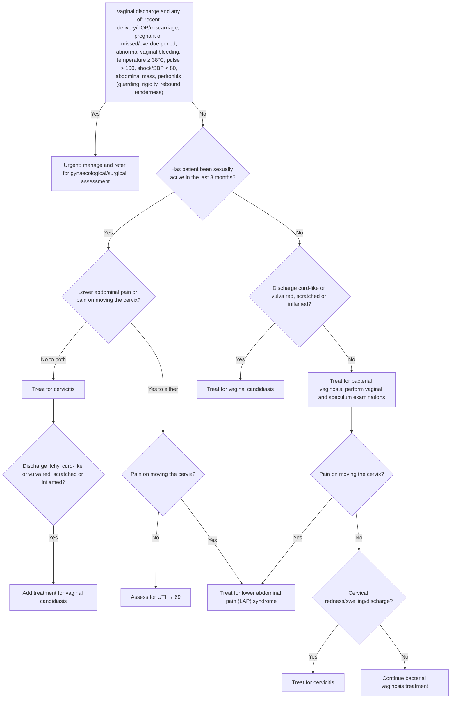

# Page 64 – Abnormal vaginal discharge: flowchart

Source: `inputs/2026/p64.png` (APC 2026). Red box = urgent triage; the lower half is the
"Approach to a patient with an abnormal vaginal discharge not needing urgent attention".

## Decision nodes → rules

| Node | Modelled as | Rule |
|---|---|---|
| Red box | `(and Vaginal discharge (or …red box items…))`; Shock/SBP < 80 as `(or Shock, SBP < 80)`; peritonitis as `(or Peritonitis, guarding, rigidity, rebound tenderness)` | `Urgent: vaginal discharge with danger signs` |
| Sexually active in last 3 months | `Sexually active` (Yes) / `(no Sexually active)` (No); the 3-month window is not modelled | all diagnosis rules |
| SA Yes → No to both → cervicitis | `Sexually active` and `(no Lower abdominal pain)` and `(no Cervical excitation present)` | `Diagnose probable cervicitis (vaginal discharge approach)`, first branch |
| …→ itchy/curd-like/vulva signs → add candidiasis | first branch plus `(or Pruritus of vagina, Erythema of vulva, Scratch marks @ vulva, Inflammation of vulva)`; curd-like has no SNOMED concept | `Diagnose probable vaginal candidiasis (vaginal discharge approach)`, first branch |
| SA Yes → Yes to either → CMT No → assess for UTI | `Sexually active` and `Lower abdominal pain` and `(no Cervical excitation present)` | `Diagnose possible UTI (vaginal discharge approach)` |
| SA Yes → Yes to either → CMT Yes → LAP syndrome | `Sexually active` and `Cervical excitation present` | `Diagnose probable LAP syndrome (vaginal discharge approach)`, first branch |
| SA No → curd-like/vulva signs Yes → candidiasis | `(no Sexually active)` and `(or vulva signs)` | `Diagnose probable vaginal candidiasis (vaginal discharge approach)`, second branch |
| SA No → No → bacterial vaginosis | `(no Sexually active)` and `(no …)` for each vulva sign | `Diagnose probable bacterial vaginosis (vaginal discharge approach)` |
| BV → CMT Yes → LAP syndrome | `(no Sexually active)`, `(no …)` vulva signs, `Cervical excitation present` | `Diagnose probable LAP syndrome (vaginal discharge approach)`, second branch |
| BV → CMT No → cervical redness/swelling/discharge Yes → cervicitis | `(no Sexually active)`, `(no …)` vulva signs, `(no Cervical excitation present)`, `(or cervical erythema, cervical swelling, Cervical discharge)` | `Diagnose probable cervicitis (vaginal discharge approach)`, second branch |
| BV → … No → continue BV treatment | same diagnosis as the BV node (management only) | `Diagnose probable bacterial vaginosis (vaginal discharge approach)` |

## Notes

- "Treat for X" nodes are encoded as `probable` X, following the gold standard (page 20, "Treat for
  anaphylaxis" → probable anaphylaxis). "Assess for UTI" is encoded as `possible`.
- LAP syndrome is mapped to `Female pelvic inflammatory disease` (no LAP-syndrome concept exists).
- Medicines, partner notification, return advice and referral are management and are not modelled.
