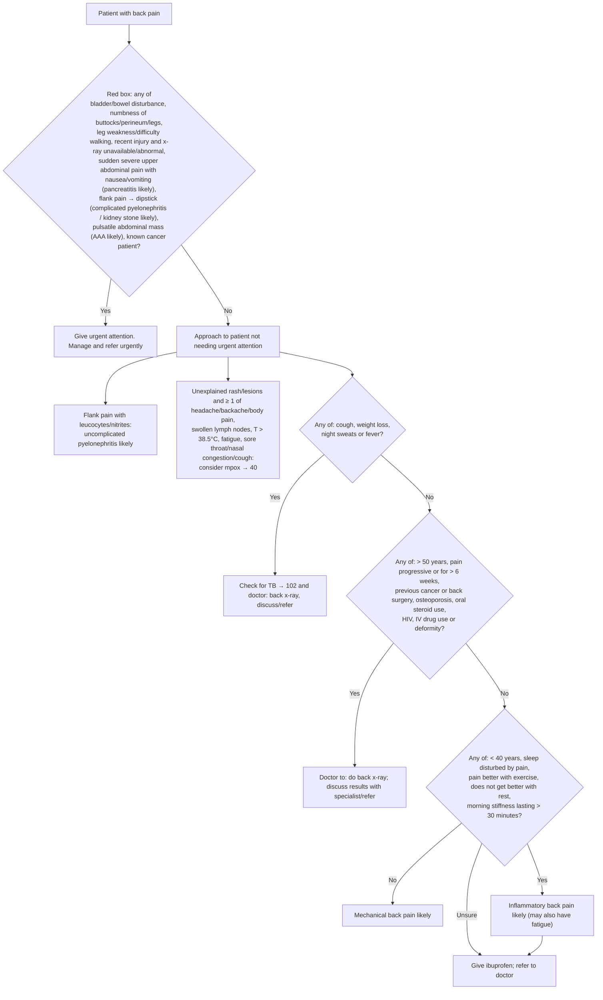

# Page 78 – Back pain: flowchart

Source: APC 2026 e-book page 78 (`inputs/2026/p78.png`): red box, then "Approach to patient with
back pain not needing urgent attention".

## Decision nodes → rules

| Node | Modelled as | Rule |
|---|---|---|
| Red box items | `check_for` of every red-box finding, triggered by Backache | `Check for urgent back pain conditions` |
| "If flank pain, check urine dipstick" | dipstick findings checked when back pain and flank pain | `Check urine dipstick in back pain with flank pain` |
| Sudden onset severe upper abdominal pain with nausea/vomiting | `probable` Acute pancreatitis | `Diagnose probable pancreatitis in back pain` |
| Flank pain, leucocytes/nitrites and a complicating factor | `probable` Acute pyelonephritis (no SNOMED concept for "complicated"); urgency written from the criteria themselves | `Diagnose probable complicated pyelonephritis in back pain` |
| Flank pain, blood, sudden severe one-sided pain radiating to groin | `probable` Kidney stone | `Diagnose probable kidney stone in back pain` |
| Pulsatile abdominal mass | `probable` Abdominal aortic aneurysm | `Diagnose probable abdominal aortic aneurysm in back pain` |
| Red box = Yes | Backache **and** any red-box item | `Urgent: back pain with red box features` |
| Uncomplicated pyelonephritis | `probable` Acute pyelonephritis from flank pain and leucocytes/nitrites | `Diagnose probable uncomplicated pyelonephritis in back pain` |
| Consider mpox | `possible` Monkeypox | `Diagnose possible mpox in back pain` |
| Q1 = Yes → Check for TB | `possible` Tuberculosis | `Diagnose possible TB in back pain` |
| Q2 = Yes → doctor x-ray | No diagnosis named on the page; not a rule. The Q2 findings are used as `(no …)` on the way to mechanical back pain | (none) |
| Q1 = No, Q2 = No, Q3 = No | `probable` Mechanical low back pain, every Q1–Q3 item recorded as No | `Diagnose probable mechanical back pain` |
| Q3 = Yes → Inflammatory back pain likely | Not modelled: no SNOMED concept for inflammatory back pain | (none; see remaining questions) |
| Q3 = Unsure | Management only | (none) |

## Notes

- Age criteria (> 50 years, < 40 years) cannot be expressed in the language; see remaining questions.
- "For > 6 weeks" is written as onset of backache at least 6 weeks ago; the No branch as onset
  within the last 6 weeks (`<=`), since only `>=`/`<=` are accepted in onset comparisons.
