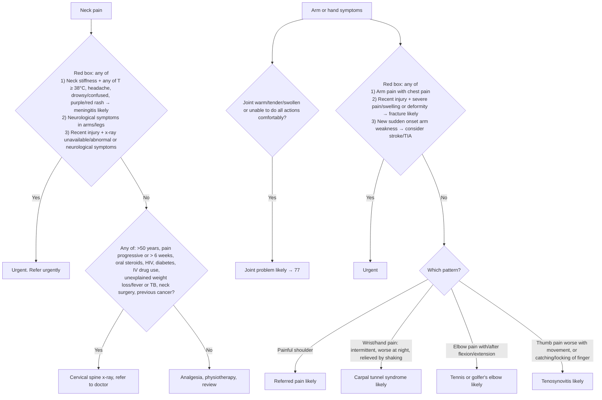

# Page 79 – Neck pain / Arm or hand symptoms: flowchart

Source: APC 2026 page 79 image (two red boxes, a Yes/No approach for neck pain, and four "likely" columns for arm or hand symptoms).

## Decision nodes → rules

| Node | Modelled as | Rule |
|---|---|---|
| RB2 item 1 | Stiff neck AND any of T ≥ 38 °C, headache, drowsy, acute confusion, purpuric or erythematous rash | `Diagnose probable meningitis from neck stiffness (neck pain page)` |
| RB2 (all items) | Neck pain AND (active meningitis OR any limb neuro symptom OR (recent neck injury AND (abnormal C-spine x-ray OR neuro symptom))) | `Urgent: neck pain with meningitis, neurological symptoms or recent injury` |
| RB2 findings | check list | `Check for urgent neck pain conditions` |
| QN | Not modelled (no diagnosis; management routing) | — |
| J | Upper-limb finding AND (joint warm / tender / swollen / limitation of joint movement) | `Diagnose probable joint problem (arm or hand symptoms)` |
| RB1 item 2 | Recent upper-limb injury AND (severe arm pain OR severe swelling OR deformity) | `Diagnose probable fracture of upper limb (arm or hand symptoms)` |
| RB1 item 3 | Sudden-onset upper-limb weakness | `Diagnose possible stroke from sudden arm weakness (arm or hand symptoms)`, `Diagnose possible TIA from sudden arm weakness (arm or hand symptoms)` |
| RB1 (all items) | Upper-limb finding AND ((arm pain AND chest pain) OR active fracture of upper limb OR sudden arm weakness) | `Urgent: arm or hand symptoms with chest pain, fracture or sudden weakness` |
| RP | Pain of shoulder region | `Diagnose probable referred pain from painful shoulder (arm or hand symptoms)` |
| CTS | Intermittent wrist or hand pain AND night pain | `Diagnose probable carpal tunnel syndrome (arm or hand symptoms)` |
| TE | Elbow pain | `Diagnose probable tennis or golfer's elbow (arm or hand symptoms)` |
| TS | Thumb pain OR catching/locking of finger | `Diagnose probable tenosynovitis (arm or hand symptoms)` |
| RB1/RB2 findings | check list | `Check for arm or hand symptom conditions` |

## Notes

- "Refer urgently", ceftriaxone, collar/immobilisation, analgesia, splints and referrals are management, not modelled.
- Optional "may be/may have" features (numbness/tingling of fingers, weakness of hand, decreased grip strength) and "with/without difficulty speaking or visual disturbance" are not criteria and are not modelled.
