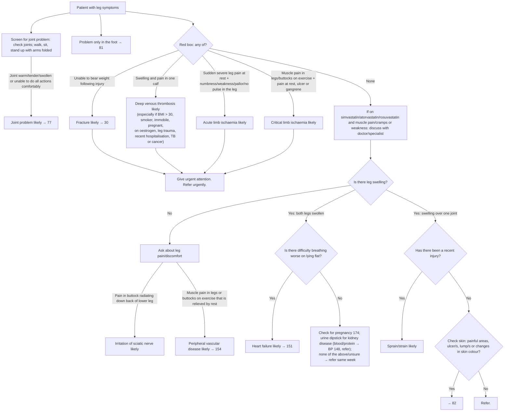

# Page 80 – Leg symptoms: flowchart

Source: APC 2026 e-book, page 80 (`inputs/2026/p80.png`). Red box, top screening bullets, and the
"Approach to the patient with leg symptoms not needing urgent attention" flowchart.

## Decision nodes → rules

| Node | Modelled as | Rule |
|---|---|---|
| Patient with leg symptoms | `(or (clinical_finding Finding of lower limb) (clinical_finding Muscle pain))`; descendants match | trigger of `Check for urgent leg symptom conditions` and `Check for causes of leg symptoms not needing urgent attention` |
| Joint screen → joint problem likely | `or` of Joint warm, Tenderness of joint, Joint swelling, Difficulty walking, Difficulty sitting down, Difficulty standing up | `Diagnose probable joint problem from leg symptom screen` |
| Problem only in the foot → 81 | routing only | not encoded |
| Unable to bear weight following injury | Unable to weight-bear **and** Injury of lower limb | `Diagnose probable fracture of lower limb (leg symptoms)` |
| Swelling and pain in one calf | Swollen calf (Unilateral) **and** Pain in calf | `Diagnose probable deep venous thrombosis (leg symptoms)` |
| Sudden severe leg pain at rest + any of numbness, weakness, pallor, no pulse in the leg | Pain in lower limb with Sudden onset + Severe + At rest **and** `or` of the four leg signs | `Diagnose probable acute limb ischaemia (leg symptoms)` |
| Muscle pain on exercise + pain at rest, ulcer or gangrene | Intermittent claudication **and** `or` of leg pain At rest, Ulcer of lower extremity, Gangrene in lower limb | `Diagnose probable critical limb ischaemia (leg symptoms)` |
| Give urgent attention | leg-symptom trigger **and** `or` of the four `active_condition`s | `Urgent: leg symptoms with fracture, DVT or limb ischaemia` |
| Statin + muscle pain/cramps/weakness | management (discuss) | not encoded |
| Leg swelling = No → pain in buttock radiating down back of lower leg | Pain in buttock **and** pain radiating to left or right leg | `Diagnose probable sciatic nerve irritation (leg symptoms)` |
| Leg swelling = No → muscle pain on exercise relieved by rest | Intermittent claudication (SNOMED: muscle pain, provoked by exertion, relieved by rest) | `Diagnose probable peripheral vascular disease (leg symptoms)` |
| Both legs swollen → orthopnoea = Yes | Swelling of bilateral lower limbs **and** Orthopnea | `Diagnose probable heart failure (bilateral leg swelling)` |
| Both legs swollen → orthopnoea = No | pregnancy check, urine dipstick, refer: management/routing | not encoded |
| Swelling over one joint → recent injury = Yes | Joint swelling **and** Injury of lower limb | `Diagnose probable sprain of lower limb (swollen joint after injury)`, `Diagnose probable strain of lower limb (swollen joint after injury)` |
| Recent injury = No → skin check → 82 / Refer | routing only | not encoded |

## Notes

- The "Is there leg swelling? = No" gate before the sciatica and PVD branches is not required as
  `(no …)` evidence; see remaining questions.
- "Recent" (injury) has no number on the page, so no time comparison is used.
