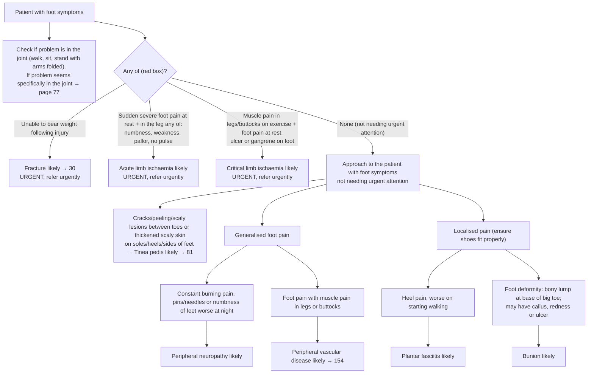

# Page 81 – Foot symptoms: flowchart

Source: `inputs/2026/p81.png` (APC 2026 e-book, page 81). Red box at the top. Below it, an
approach for the patient who needs no urgent attention.

## Decision nodes → rules

| Node | Modelled as | Rule |
|---|---|---|
| Patient with foot symptoms | `(clinical_finding "Finding of foot region")`; descendants (foot pain, heel pain, foot ulcer, …) match | trigger of `Check for urgent foot symptom conditions` and `Check for causes of foot symptoms not needing urgent attention` |
| Unable to bear weight following injury → fracture likely | Unable to weight-bear **and** injury of lower limb | `Diagnose probable fracture with foot symptoms` |
| Sudden severe foot pain at rest + leg numbness/weakness/pallor/no pulse → acute limb ischaemia likely | Foot pain (sudden onset, severe) **and** rest pain in foot **and** any of numbness of lower limb, weakness of lower limb muscle, white skin discoloration of lower limb, foot pulse absent | `Diagnose probable acute lower limb ischaemia with foot symptoms` |
| Muscle pain in legs/buttocks on exercise + foot rest pain/ulcer/gangrene → critical limb ischaemia likely | Intermittent claudication **and** any of rest pain in foot, ulcer of foot, gangrene of foot | `Diagnose probable critical lower limb ischaemia with foot symptoms` |
| Red box → urgent | Foot symptoms **and** any of the three red-box diagnoses (active) | `Urgent: foot symptoms with fracture or limb ischaemia` |
| Tinea pedis likely | Any of fissure/peeling/scaly skin between toes, scaly skin of sole/heel/sides of foot | `Diagnose probable tinea pedis from foot skin changes` |
| Generalised foot pain → burning/pins and needles/numbness → peripheral neuropathy likely | Generalised foot pain **and** any of burning pain of foot, pins and needles of foot, numbness of foot | `Diagnose probable peripheral neuropathy from foot symptoms` |
| Generalised foot pain → with muscle pain in legs/buttocks → PVD likely | Generalised foot pain **and** any of muscle pain of lower limb, muscle pain of buttock | `Diagnose probable peripheral vascular disease from foot symptoms` |
| Localised → heel pain worse on starting walking → plantar fasciitis likely | Heel pain **and** pain provoked by walking | `Diagnose probable plantar fasciitis from heel pain` |
| Localised → foot deformity, bony lump at base of big toe → bunion likely | Deformity of foot **and** bony swelling of first MTP joint | `Diagnose probable bunion from foot deformity` |
| Joint check → 77 | Not modelled (pointer to another page) | – |

## Notes

- "Refer urgently", all treatment bullets, the diabetes/PVD "foot at risk" review and the foot-care
  advice are management and are not modelled.
- "Constant", "worse at night", "worse on starting walking" (as opposed to any walking) and
  "thickened" are not expressible with confirmed SNOMED forms; see the remaining-questions file.
