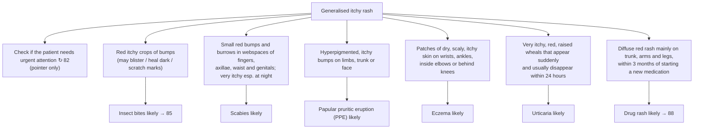

# Page 84 – Generalised itchy rash: flowchart

Source: APC 2026 e-book page 84 (image `inputs/2026/p84.png`). The page has no Yes/No arrows. It is
a pointer red box followed by a picture-matching differential: each panel's description leads to an
"X likely" box.

## Decision nodes → rules

| Node | Modelled as | Rule |
|---|---|---|
| Presenting complaint | Pruritic rash or Generalized rash or Generalized pruritus | `Check for causes of generalised itchy rash` (trigger) |
| Red box (pointer to 82) | Not modelled here (cross-reference only) | none |
| Insect bites likely | Papule of skin, Grouped | `Diagnose probable insect bites (generalised itchy rash)` |
| Scabies likely | Burrows in skin **and** papule at finger webspace / axilla / waist / genitals | `Diagnose probable scabies (generalised itchy rash)` |
| PPE likely | Hyperpigmentation of skin **and** papule on limb / trunk / face | `Diagnose probable papular pruritic eruption (generalised itchy rash)` |
| Eczema likely | Xeroderma **and** scaly skin at wrist / ankle / cubital fossa / popliteal fossa | `Diagnose probable eczema (generalised itchy rash)` |
| Urticaria likely | Wheal, Sudden onset | `Diagnose probable urticaria (generalised itchy rash)` |
| Drug rash likely | Erythematous rash **and** New medication commenced within the last 3 months | `Diagnose probable drug rash (generalised itchy rash)` |
