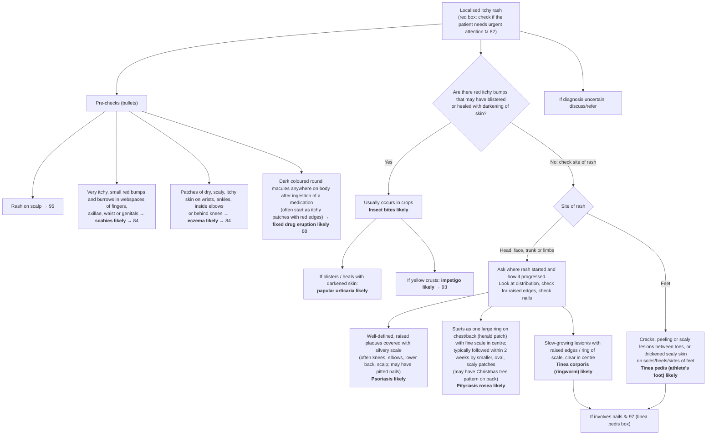

# Page 85 – Localised itchy rash: flowchart

Source: APC 2026 e-book, page 85 (`inputs/2026/p85.png`). The red box is a pointer only
("Check if the patient needs urgent attention ↻ 82"); the page's own logic is the bullet list and
the Yes/No algorithm below it.

## Decision nodes → rules

| Node | Modelled as | Rule |
|---|---|---|
| Presenting complaint | `Pruritic rash` (disorder); "localised" has no separate concept | `Check for localised itchy rash conditions` (trigger) |
| Red box ↻ 82 | Pointer only; not encoded on this page | — |
| Rash on scalp → 95 | Pointer only | — |
| Scabies likely | Severe itching **and** papules **and** burrows at any of: finger web, axilla, waist, genitals | `Diagnose probable scabies (localised itchy rash)` |
| Eczema likely | Itchy rash **and** dry skin **and** scaly skin at any of: wrist, ankle, antecubital region, popliteal region | `Diagnose probable eczema (localised itchy rash)` |
| Fixed drug eruption likely | Round skin macules **and** skin hyperpigmentation **and** exposure to a drug | `Diagnose probable fixed drug eruption (localised itchy rash)` |
| Q1 = Yes → Insect bites likely | Itchy rash **and** skin papules (the "may have blistered or healed with darkening" part is optional on the page) | `Diagnose probable insect bites (localised itchy rash)` |
| Papular urticaria likely | Itchy rash **and** papules **and** (skin blister **or** post-inflammatory hyperpigmentation) | `Diagnose probable papular urticaria (localised itchy rash)` |
| Impetigo likely | Itchy rash **and** papules **and** yellow crust on skin | `Diagnose probable impetigo (localised itchy rash)` |
| Q1 = No, site head/face/trunk/limbs → Psoriasis likely | Well-defined raised skin plaque **and** silver-coloured scaly skin | `Diagnose probable psoriasis (localised itchy rash)` |
| → Pityriasis rosea likely | Annular skin lesion on chest or back skin (herald patch) **and** multiple oval-shaped lesions | `Diagnose probable pityriasis rosea (localised itchy rash)` |
| → Tinea corporis likely | Annular raised skin lesion **or** annular scaly skin | `Diagnose probable tinea corporis (localised itchy rash)` |
| Q1 = No, site feet → Tinea pedis likely | Fissure, peeling or scaly skin of the interdigital web of foot, **or** thickened and scaly skin of the sole, heel or lateral border of foot | `Diagnose probable tinea pedis (localised itchy rash)` |
| If involves nails ↻ 97; surrounding skin red/warm/swollen ↻ 93; extensive/recurrent → HIV/diabetes tests; refer | Management / pointers; not encoded | — |
| If diagnosis uncertain, discuss/refer | Management; not encoded | — |

## Notes

- The "No" answer to Q1 is not required as `(no …)` evidence for the No-branch diagnoses: each
  No-branch description is distinctive on its own, and requiring an explicit "No" would stop the
  rules firing when the health worker records only the positive findings (same approach as the
  gold standard's Q2 = No branch).
- The site split (head/face/trunk/limbs vs feet) is carried by the findings themselves: tinea pedis
  findings have foot sites; the head/face/trunk/limbs diagnoses are not restricted by site.
