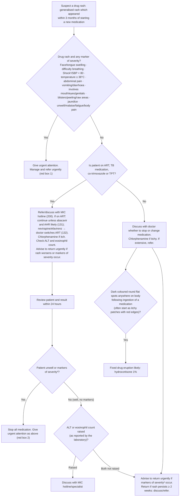

# Page 88 – Drug rash: flowchart

Source: `inputs/2026/p88.png` (APC 2026, page 88). Red box 1 (urgent markers of severity), the
"Approach to the patient with a drug rash not needing urgent attention" algorithm, and red box 2.

¹ If SBP < 80, pulse ≥ 100, respiratory rate > 30, confusion/restlessness, weakness, shock likely.
² Markers of severity: face/tongue swelling, difficulty breathing, BP < 90/60, temperature ≥ 38°C,
abdominal pain, vomiting/diarrhoea, involves mouth/eyes/genitals, blisters/peeling/raw areas,
jaundice, unwell/malaise/fatigue/body pain.

## Decision nodes → rules

| Node | Modelled as | Rule |
|---|---|---|
| Suspect a drug rash | Generalised rash **and** exposure to a drug or medicament whose onset is within the last 3 months; or a recorded drug eruption | `Diagnose possible drug rash` → triggers `Check for drug rash markers of severity` |
| Red box 1 (and red box 2 "unwell or markers of severity²") | Drug eruption (recorded, or possible diagnosis) **and** any marker of severity; BP < 90/60 from footnote 2 added | `Urgent: drug rash with markers of severity` |
| Q1 (ART, TB medication, co-trimoxazole, TPT?) | Not modelled: routes management only | — |
| Review within 24 hours; ALT/eosinophil count | Not modelled: lab values have no representation; routes management only | — |
| Fixed drug eruption likely | Hyperpigmentation of skin **and** macule of skin **and** exposure to a drug or medicament | `Diagnose probable fixed drug eruption` |
| Management boxes (stop medication, chlorphenamine, hydrocortisone, sodium chloride, refer) | Not modelled (no `manage` tasks in this pass) | — |

## Notes

- "Within 3 months of starting a new medication" is approximated as the onset of the drug
  exposure finding being within the last 3 months (`<=`), not as the interval between the drug
  start and rash onset.
- The fixed drug eruption statement sits in the "No" branch (not on ART/TB medication/
  co-trimoxazole/TPT). That branch condition is not encoded, so the rule can also fire for patients
  on those medicines.
