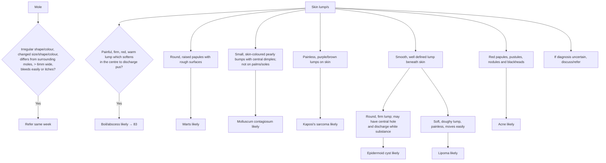

# Page 89 – Skin lump/s: flowchart

Source: `inputs/2026/p89.png`. The page is a set of description → "X likely" boxes under a red box for moles.

## Decision nodes → rules

| Node | Modelled as | Rule |
|---|---|---|
| Mole red box | Melanocytic nevus **and** any feature (6 of 7 modelled; "differs from surrounding moles" has no concept); width via a measure task, > 6 mm | `Check for concerning features of a mole`, `Measure the width of a mole`, `Urgent: mole needing referral this week` |
| Boil/abscess | painful (Pain at skin) **and** firm **and** red **and** warm **and** (fluctuant **or** skin discharge) | `Diagnose probable boil from a skin lump`, `Diagnose probable skin abscess from a skin lump` |
| Warts | Papule of skin **and** Rough skin | `Diagnose probable warts from a skin lump` |
| Molluscum | Papule **and** Skin dimple **and** no papule on palm **and** no papule on sole | `Diagnose probable molluscum contagiosum from a skin lump` |
| Kaposi's sarcoma | (purple **or** brown skin mass) **and** painless skin mass | `Diagnose probable Kaposi's sarcoma from a skin lump` |
| Epidermoid cyst | well defined subcutaneous mass **and** firm subcutaneous mass | `Diagnose probable epidermoid cyst from a skin lump` |
| Lipoma | well defined **and** soft **and** painless subcutaneous mass (moves easily: no concept) | `Diagnose probable lipoma from a skin lump` |
| Acne | Comedone, **or** any 2 of papule / pustule / skin nodule | `Diagnose probable acne from a skin lump` |
| Pre-screen | Mass of skin or Mass of subcutaneous tissue | `Check for features of a skin lump` |
