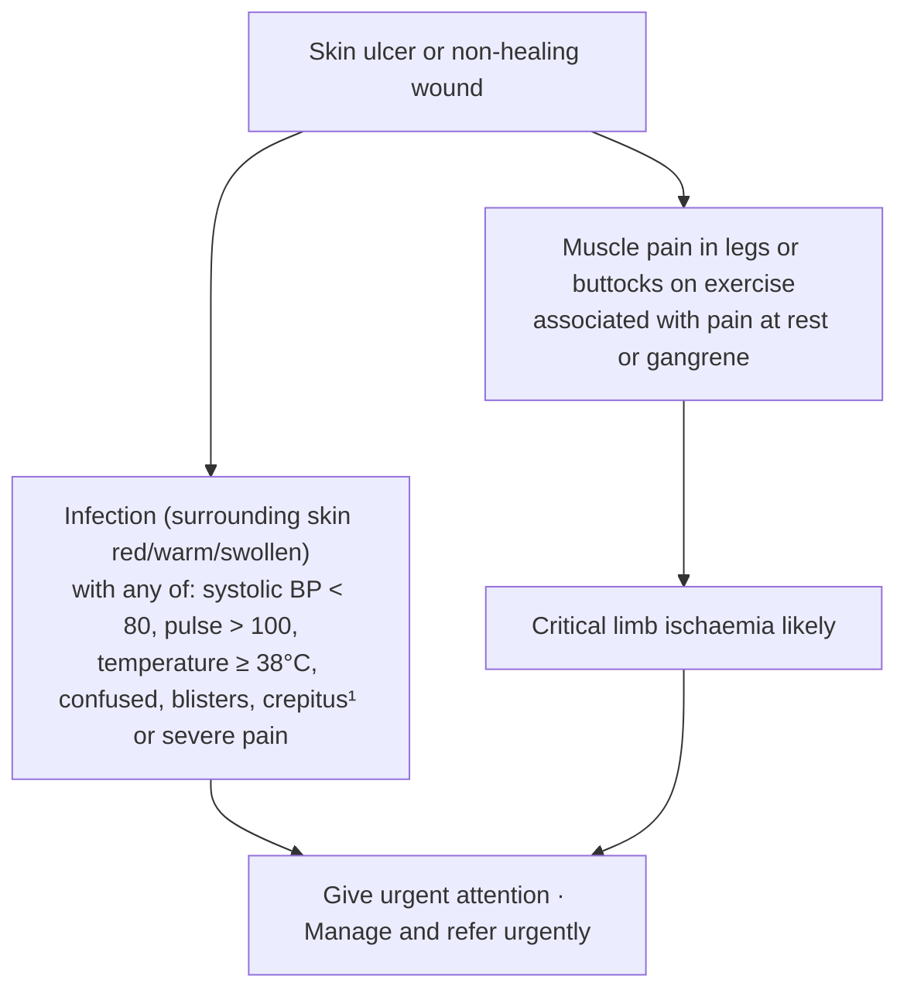
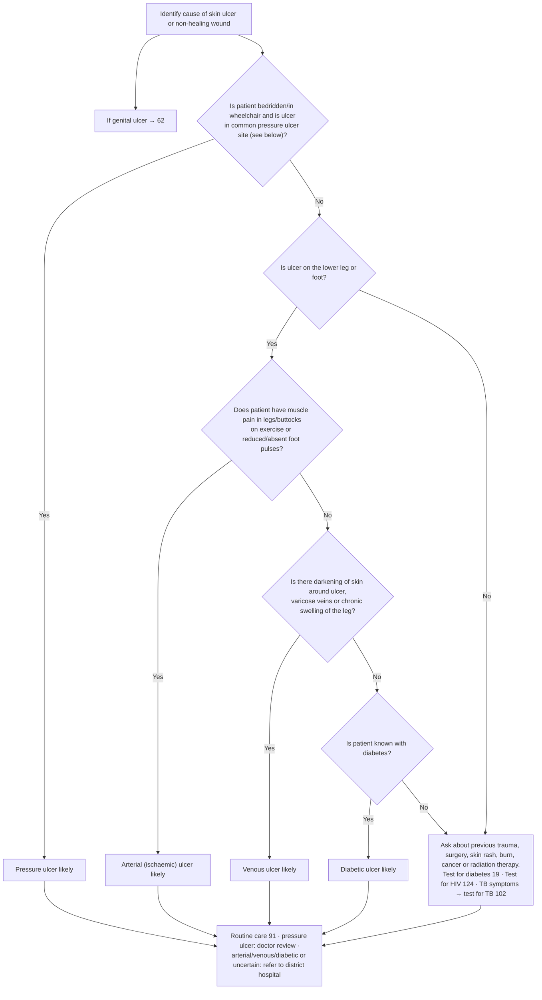

# Page 90 – Skin ulcer or non-healing wound: diagnosis: flowchart

Source: APC 2026 e-book, page 90 (page image `p90.png`; red box `p90-box1.png`).

## Red box (urgent attention)

## Identify cause

¹ Crepitus is a crackling, popping or grating sound or feeling under the skin.

## Decision nodes → rules

| Node | Modelled as | Rule |
|---|---|---|
| Presenting complaint | `Skin ulcer` (disorder) or `Chronic wound` (disorder) | trigger of `Check for skin ulcer or non-healing wound danger signs and cause` |
| RB1 | (any infection sign: infected ulcer of skin, local wound infection, erythema, warm skin, swelling) **and** (any of SBP < 80, pulse > 100, temperature ≥ 38, acute confusion, blister of skin, subcutaneous crepitus, severe pain) | `Urgent: skin ulcer or non-healing wound with infection or critical limb ischaemia` |
| RB2 → critical limb ischaemia likely | ulcer/wound **and** intermittent claudication **and** (pain provoked by rest or gangrenous disorder) | `Diagnose probable critical limb ischaemia in skin ulcer or non-healing wound`; its `active_condition` feeds the urgent rule |
| Q1 = Yes → pressure ulcer likely | ulcer/wound **and** (bed-ridden or dependence on wheelchair). The "common pressure ulcer site" half is not modelled (the sites are only shown in a picture) | `Diagnose probable pressure ulcer` |
| Q1 = No | Not modelled as a condition on the later branches (see remaining questions) | — |
| Q2 = Yes | ulcer/wound with `finding_site` lower leg (`Structure of lower limb from knee to ankle`) or `Foot structure` | used in the arterial, venous and diabetic rules |
| Q3 = Yes → arterial ulcer likely | leg/foot ulcer **and** (intermittent claudication, foot pulse absent or abnormal foot pulse) | `Diagnose probable arterial (ischaemic) ulcer` |
| Q3 = No → Q4 = Yes → venous ulcer likely | leg/foot ulcer **and** `(no …)` of each Q3 item **and** (hyperpigmentation of skin, varicose veins of lower extremity, or chronic leg swelling) | `Diagnose probable venous ulcer` |
| Q4 = No → Q5 = Yes → diabetic ulcer likely | leg/foot ulcer **and** `(no …)` of each Q3 and Q4 item **and** known diabetes | `Diagnose probable diabetic ulcer` |
| Q5 = No / Q2 = No → cause uncertain | No diagnosis; the box is history-taking, tests and cross-references | — |
| Genital ulcer → 62 | Cross-reference only | — |
| Bottom box (routine care, review, referral) | Management | — |
