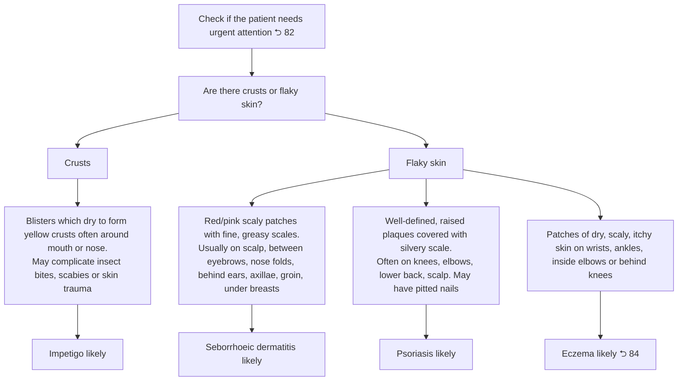

# Page 93 – Crusts or flaky skin: flowchart

Source: `inputs/2026/p93.png`. The red box is a pointer only ("Check if the patient needs urgent attention ⮌ 82").

## Decision nodes → rules

| Node | Modelled as | Rule |
|---|---|---|
| Red box | Pointer to page 82; not encoded | — |
| Are there crusts or flaky skin? | Trigger: Crust on skin **or** Scaly skin | `Check for crusts or flaky skin conditions` |
| Crusts → Impetigo likely | Blister of skin **and** Crust on skin (Yellow color) | `Diagnose probable impetigo (crusts or flaky skin)` |
| Flaky skin → Seborrhoeic dermatitis likely | Scaly skin **and** Erythema **and** Greasy skin | `Diagnose probable seborrhoeic dermatitis (crusts or flaky skin)` |
| Flaky skin → Psoriasis likely | Skin plaque **and** Scaly skin (Silver color) | `Diagnose probable psoriasis (crusts or flaky skin)` |
| Flaky skin → Eczema likely | Xeroderma **and** Itching of skin **and** Scaly skin at wrist / ankle / cubital fossa / popliteal region | `Diagnose probable eczema (crusts or flaky skin)` |

## Notes

- "Usually on …", "often on …", "often around mouth or nose", "may complicate …" and "may have pitted nails" describe typical presentations, not requirements, and are not encoded.
- Management text under each diagnosis is out of scope (no `manage` tasks).
