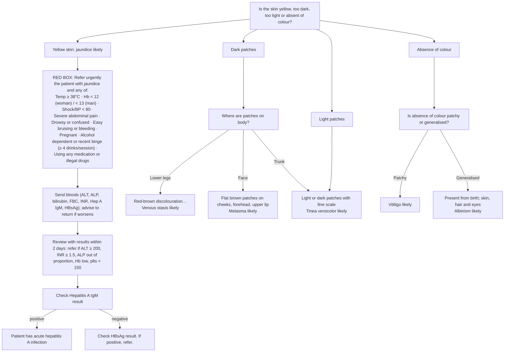

# Page 94 – Changes in skin colour: flowchart

Source: `inputs/2026/p94.png` (APC 2026, page 94).

## Decision nodes → rules

| Node | Modelled as | Rule |
|---|---|---|
| Q0 (colour type) | `check_for` of yellow skin, hyperpigmentation by site, hypopigmentation, achromia patchy/generalised | `Check for type of skin colour change (changes in skin colour)` |
| Yellow skin → jaundice likely | Yellow skin | `Diagnose probable jaundice (changes in skin colour)` |
| Red box | Jaundice (finding or active condition) **and** any red-box item (Hb omitted: not representable) | `Check for urgent jaundice conditions (changes in skin colour)`, `Urgent: jaundice with danger signs (changes in skin colour)` |
| Bloods, review, Hep A IgM / HBsAg | Lab results: not representable; management | not encoded |
| Dark → Lower legs | Hyperpigmentation of skin at lower limb (knee to ankle) | `Diagnose probable venous stasis (changes in skin colour)` |
| Dark → Face | Hyperpigmentation of skin at face | `Diagnose probable melasma (changes in skin colour)` |
| Dark → Trunk, or Light patches | Hyperpigmentation at trunk, or hypopigmentation of skin | `Diagnose probable tinea versicolor (changes in skin colour)` |
| Absence → Patchy | Achromia of skin, Patchy | `Diagnose probable vitiligo (changes in skin colour)` |
| Absence → Generalised | Achromia of skin, Generalized | `Diagnose probable albinism (changes in skin colour)` |

## Notes

- The descriptive text in each diagnosis box is treated as a picture of the condition, not as an extra
  criterion; the rules follow the routing.
- Footnote 1 (shock definition) is not imported.
