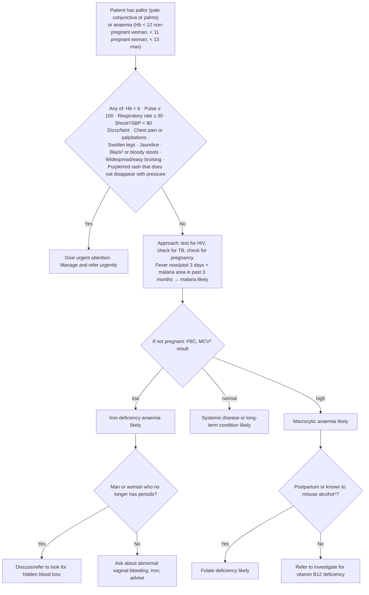

# Page 44 – Pallor and anaemia: flowchart

Source: `inputs/2026/p44.png` (APC 2026 e-book, page 44). Only the red box (urgent attention) is
encoded as rules. The approach section below it (MCV algorithm) is drawn here for traceability but
sits outside the red box, so its element inventory has no keys and it is not encoded (see
remaining-questions, **Could not model**).

¹ If SBP < 80, pulse ≥ 100, respiratory rate > 30, confusion/restlessness, weakness, shock likely.
² Black stools may be caused by iron tablets. ³ Mean cell volume. ⁴ > 14 drinks/week or ≥ 4 drinks/session.

## Decision nodes → rules

| Node | Modelled as | Rule |
|---|---|---|
| P (presenting complaint) | Pale conjunctiva, pale skin (`Pale discoloration of entire skin of body`), or anaemia recorded as a finding | `Check for urgent pallor/anaemia conditions` (trigger); first `and` arm of `Urgent: pallor/anaemia with danger signs` |
| U = Yes | `(and <pallor/anaemia> (or …red-box items…))`. Pulse, RR and SBP as vital measurements. Hb < 6 **not encoded** (no Hb unit in the language) | `Urgent: pallor/anaemia with danger signs` |
| U = No → APP, FBC, IDA, SYS, MAC, Q1, Q2, FOL, B12 | Outside the red box: not encoded in this pass | — |
| Footnote ¹ (shock definition) | Not used; "Shock/SBP < 80" encoded as written (decision for all pages) | — |
