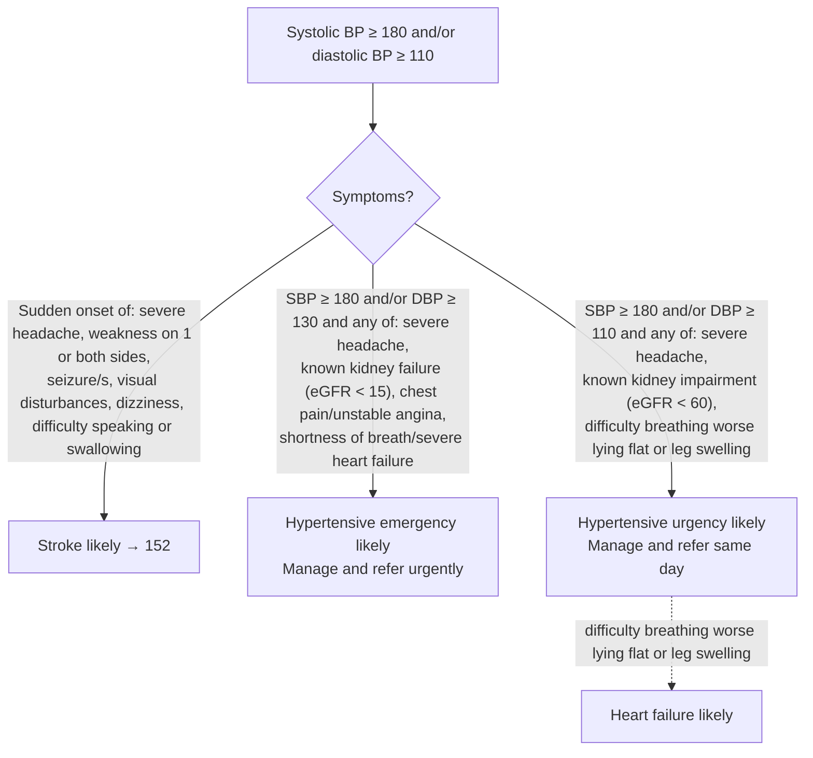
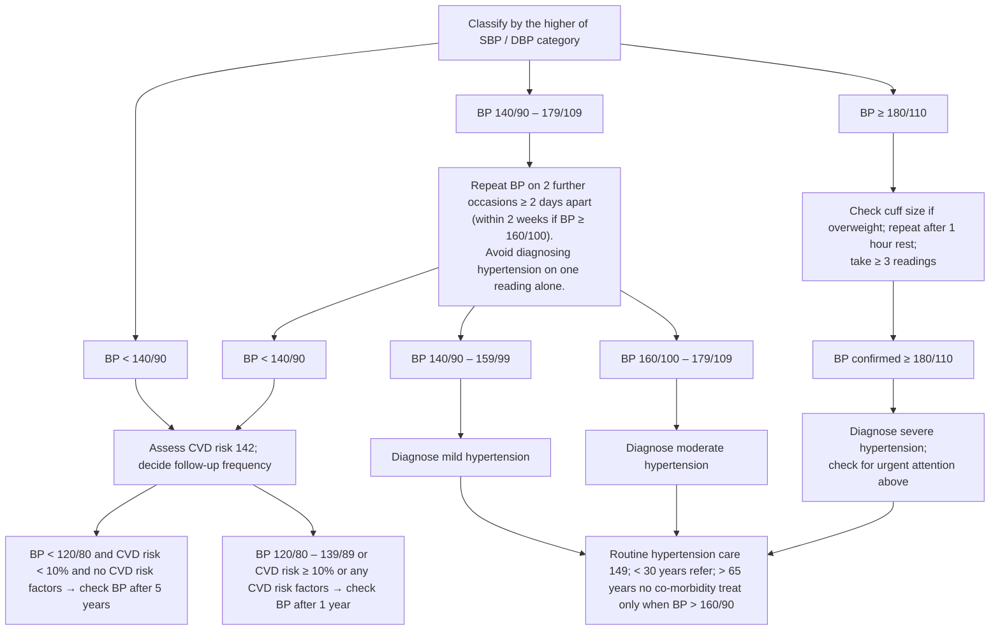

# Page 148 – Hypertension: diagnosis: flowchart

Source: APC 2026 e-book page 148 (red box and the "Approach to interpreting a BP" chart below it).

## Red box (urgent attention)

## Approach to interpreting a BP in a patient not needing urgent attention

## Decision nodes → rules

| Node | Modelled as | Rule |
|---|---|---|
| SBP ≥ 180 and/or DBP ≥ 110 | `(or (>= SBP 180) (>= DBP 110))`, triggers the check | `Check for urgent symptoms with BP ≥ 180/110` |
| Stroke likely | BP ≥ 180/110 **and** any sudden-onset item | `Diagnose probable stroke with BP ≥ 180/110 (hypertension diagnosis)` |
| Hypertensive emergency likely | `(or (>= SBP 180) (>= DBP 130))` **and** any of the four items | `Diagnose probable hypertensive emergency` |
| Hypertensive urgency likely | BP ≥ 180/110 **and** any of the three items | `Diagnose probable hypertensive urgency` |
| Heart failure likely | BP ≥ 180/110 **and** (orthopnoea or leg swelling) | `Diagnose probable heart failure with BP ≥ 180/110 (hypertension diagnosis)` |
| Give urgent attention | BP ≥ 180/110 **and** any red-box symptom | `Urgent: symptomatic BP ≥ 180/110 (hypertension diagnosis)` |
| Lower chart (mild / moderate / severe hypertension, follow-up) | Not modelled: needs readings on separate occasions, averaged readings, CVD risk score; see remaining questions | — |
