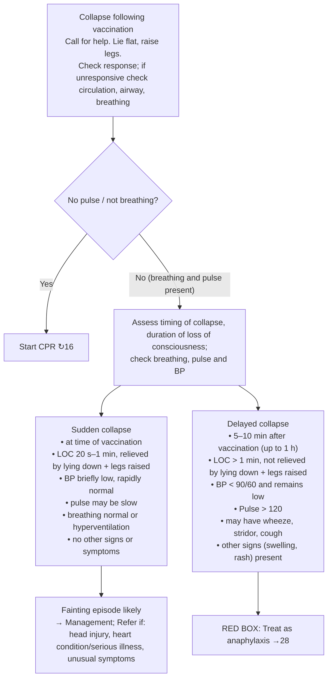

# Page 15 – Collapse following vaccination: flowchart

Source: APC 2026 e-book page 15 (APC 2026 e-book, page 15). The only red box is the pointer
"Treat as anaphylaxis →28".

## Decision nodes → rules

| Node | Modelled as | Rule |
|---|---|---|
| Presenting complaint (collapse) | `(clinical_finding Collapse)` triggers the check; vaccination recorded as `Vaccination given` (situation) | `Check for collapse following vaccination features` |
| No pulse / not breathing → CPR ↻16 | Not modelled here: cross-reference to page 16; cardiac arrest / obstructed airway are existing Emergency warning signs | — |
| Sudden collapse → Fainting episode likely | Collapse **and** vaccination given **and** no wheeze/stridor/cough/swelling/rash **and** SBP ≥ 90 **and** DBP ≥ 60 **and** pulse ≤ 120 (the complement of the delayed column's BP < 90/60 and pulse > 120) | `Diagnose probable fainting episode following vaccination` |
| Delayed collapse → Treat as anaphylaxis 28 | Collapse **and** vaccination given **and** any of: SBP < 90, DBP < 60, pulse > 120, wheeze, stridor, cough, swelling, rash | `Diagnose probable anaphylaxis after collapse following vaccination` (page 28's rules then give the urgency) |
| Timing (at time vs 5–10 min / up to 1 h) and LOC duration (20 s–1 min vs > 1 min, relieved or not) | Not representable: no time relative to another event, no event duration | — |
| Refer if … | Management / referral, out of scope | — |

## Notes

- BP < 90/60 is read as systolic < 90 **or** diastolic < 60.
- The two rules are written to be mutually exclusive: any one delayed-collapse feature routes away
  from "fainting" towards anaphylaxis.
