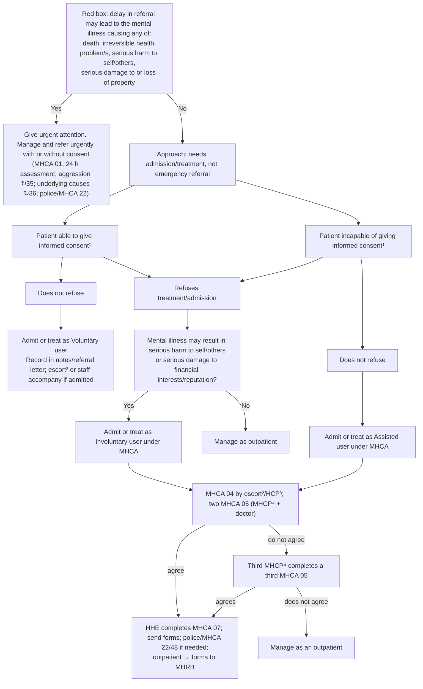

# Page 158 – The mentally ill patient needing treatment or admission: flowchart

Source: APC 2026 e-book page 158 (red box, then the "Approach to the mentally ill patient in need of
hospital admission/treatment not needing emergency referral" chart).

Below the chart: a patient with a Court/MHRB order for outpatient care is reviewed and given the
prescribed intervention regardless of consent.

## Decision nodes → rules

| Node | Modelled as | Rule |
|---|---|---|
| Red box (presenting complaint) | `(clinical_finding Mental disorder)` | `Check for urgent risks in the mentally ill patient needing admission` |
| Red box: serious harm to self/others | `At increased risk of self-injurious behavior`, `At increased risk for suicide`, `High risk of harm to others` | same task; `Urgent: mentally ill patient at risk of harm or property damage if referral delayed` |
| Red box: serious damage to or loss of property | `At increased risk for destructive behavior to property` | same task and Urgent rule |
| Red box: death, irreversible health problem/s | Not modelled (no SNOMED concept) | — |
| Manage and refer urgently | Management | — (no manage tasks) |
| Consent / refusal / voluntary / assisted / involuntary user, MHCA forms | Legal routing and management, not triage or diagnosis | — |
| Q: harm to self/others or financial interests/reputation | Legal criterion for involuntary admission; not a priority or diagnosis | — |

## Notes

- Nothing on this page says "X likely" or "consider X", so there are no diagnosis rules.
- The legal flowchart elements sit outside the red box and need no accounting.
