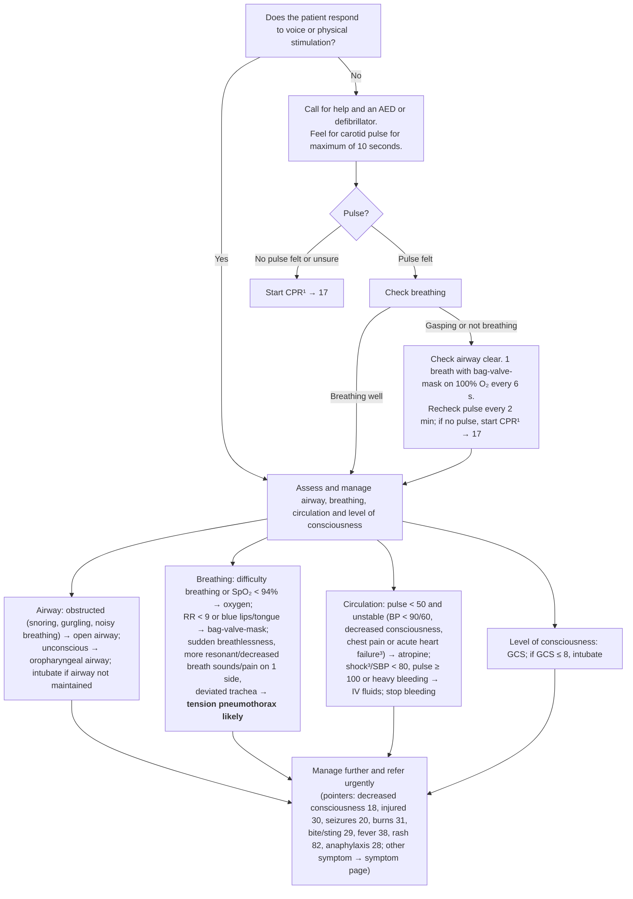

# Page 16 – The emergency patient: flowchart

Source: APC 2026 e-book page 16 (one red box, "Give urgent attention to the emergency patient").

¹ Life-limiting illness: consider whether to proceed. ³ (first) Acute heart failure: leg swelling, difficulty
breathing which worsens on lying down/with effort. ³ (second) If SBP < 80, pulse ≥ 100, respiratory rate > 30,
confusion/restlessness, weakness, **shock likely**. (The page numbers both footnotes "3".)

## Decision nodes → rules

| Node | Modelled as | Rule |
|---|---|---|
| Q1 = No (does not respond to voice or physical stimulation) | `Unresponsive` | trigger of `Check for emergency patient airway, breathing and circulation signs`; `Emergency: emergency patient unresponsive, pulseless or not breathing` |
| Q2 = No pulse felt or unsure | `Absent pulse`, or `Cardiac arrest` (warning sign) | `Emergency: emergency patient unresponsive, pulseless or not breathing` |
| Q3 = Gasping or not breathing | `Gasping for breath`, `Agonal respiration`, `Apnea` | `Emergency: emergency patient unresponsive, pulseless or not breathing` |
| Q3 = Breathing well / Q1 = Yes | No rule of its own; the patient goes on to the ABC assessment, whose findings drive the second priority rule | — |
| Airway obstructed (snoring, gurgling, noisy breathing) | `Respiratory obstruction` (warning sign) or `Snoring`, `Gurgling`, `Noisy respiration` | `Emergency: emergency patient with airway, breathing, circulation or consciousness compromise` |
| Difficulty breathing or SpO₂ < 94% | `Difficulty breathing`, SpO₂ < 94 | same |
| RR < 9 or blue lips/tongue | RR < 9, `Blue lips`, `Blue tongue` | same |
| Tension pneumothorax likely | Sudden-onset dyspnoea **and** (hyperresonance, decreased breath sounds or chest pain, each unilateral) **and** `Trachea displaced` | `Diagnose probable tension pneumothorax (emergency patient)`, then `(active_condition Tension pneumothorax)` in the second priority rule |
| Pulse < 50 and unstable | pulse < 50 **and** (SBP < 90 or DBP < 60, decreased consciousness, chest pain, `Acute heart failure`, or leg swelling **and** orthopnoea/dyspnoea on exertion from footnote 3) | second priority rule |
| Shock³/SBP < 80, pulse ≥ 100 or heavy bleeding | `(active_condition Shock)` or SBP < 80, pulse ≥ 100, severe bleeding | second priority rule |
| Shock likely (footnote) | SBP < 80 **and** pulse ≥ 100 **and** RR > 30 **and** (confusion [`Clouded consciousness` or `Acute confusion`] or restlessness) **and** weakness | `Diagnose probable shock (emergency patient)` |
| GCS ≤ 8 | `Glasgow coma scale, 3` … `Glasgow coma scale, 8` findings | second priority rule |
| Manage further and refer urgently | Management and cross-references only | not encoded |

## Notes

- Every action (CPR, AED, bag-valve-mask, airway manoeuvres, oxygen, atropine, fluids, intubation,
  chest decompression, tourniquet, recovery position) is management and is not modelled.
- Difficulty breathing is an Emergency criterion with SpO₂ < 94%, because the page lists them in one sentence (reconciler decision, unsettled; see remaining questions).
