# Page 176 – Manage the patient requesting a termination of pregnancy (TOP): flowchart

Source: APC 2026 e-book page 176. The red box is the "Yes" branch of the post-TOP review question.

```mermaid
flowchart TD
    subgraph REQ["Patient requesting a TOP (management / routing only)"]
      C1["Any of: heart disease, hypertension, asthma, diabetes, anaemia,<br/>bleeding disorder, epilepsy, substance abuse or large fibroids?"]
      C1 -- Yes --> REF1["Refer to next level of care for further TOP assessment"]
      C1 -- No --> BOOK["Arrange TOP booking within 2 weeks according to gestation"]
      BOOK --> G1["Gestation ≤ 12 weeks 0 days:<br/>24 h maternity unit / trained staff?"]
      BOOK --> G2["Gestation ≥ 12 weeks 1 day – 20 weeks:<br/>book 2nd-trimester TOP assessment"]
      G1 -- No --> REF2["Refer to facility offering 1st-trimester TOP"]
      G1 -- Yes --> OFFER["Offer medical TOP or surgical TOP (MVA);<br/>Hb, Rh, HIV, cervical screen, ultrasound/dates"]
      OFFER --> MED["Medical TOP (≤ 9 weeks / > 9 weeks regimens)"]
      OFFER --> SURG["Surgical TOP / MVA"]
      MED --> AFTER["Pain relief, return advice, follow up within 14 days"]
      SURG --> AFTER
    end

    R["Review the patient who had a TOP within the past 14 days"]
    R --> Q1["Any of: adnexal mass (closed cervix and small uterus),<br/>guarding/rebound abdominal tenderness, foul-smelling discharge,<br/>temperature ≥ 38 °C, SBP &lt; 80, pulse ≥ 100, Hb &lt; 6, RR ≥ 30?"]
    Q1 -- Yes --> URG["RED BOX: Manage urgently → 182"]
    URG --> ECT["If adnexal mass: ectopic pregnancy likely. Refer urgently."]
    Q1 -- No --> Q2["Enlarged uterus, or open cervical os with<br/>bleeding / products of conception visible?"]
    Q2 -- "Yes to either" --> INC["Incomplete TOP likely. Refer to next level of care."]
    Q2 -- "No to both" --> REASS["Reassure, contraception 170, mental health 98"]
```

## Decision nodes → rules

| Node | Modelled as | Rule |
|---|---|---|
| R (TOP within the past 14 days) | `(<= (onset (clinical_finding Induced termination of pregnancy)) (time_ago 14 days))` | trigger of `Check for complications after a termination of pregnancy`, and the first conjunct of every rule below |
| Q1 = Yes → red box | TOP within 14 days **and** any of: adnexal mass with closed cervix and small uterus, abdominal guarding, rebound tenderness, offensive vaginal discharge, temperature ≥ 38 °C, SBP < 80, pulse ≥ 100, RR ≥ 30 (Hb < 6 not representable) | `Urgent: complications within 14 days of a termination of pregnancy` |
| Red box: "If adnexal mass, ectopic pregnancy likely" | TOP within 14 days **and** adnexal mass **and** closed cervix **and** small uterus | `Diagnose probable ectopic pregnancy after a termination of pregnancy` |
| Q1 = No → Q2 = Yes | TOP within 14 days **and** (enlarged uterus **or** (cervical os open **and** (vaginal bleeding **or** products of conception at os/in vagina))) | `Diagnose probable incomplete termination of pregnancy` |
| Q2 = No to both | Reassurance / contraception / mental health | not modelled (management) |
| C1, gestation and TOP-method branches | Referral, booking, regimens | not modelled (management / routing; no diagnosis on the page) |

## Notes

- The "No" on Q1 before Q2 is not modelled; see remaining questions.
- Hb < 6 has no unit/observable in the language.
