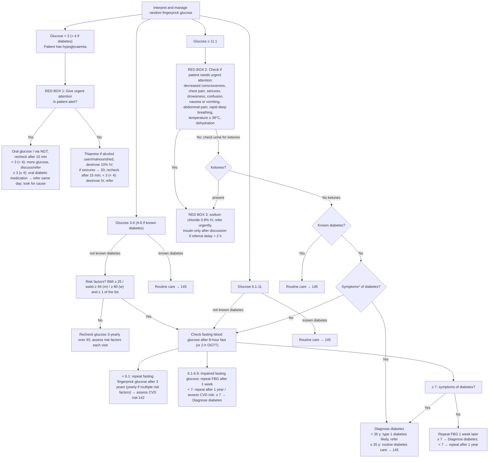

# Page 19 – Assess and manage glucose: flowchart

Source: APC 2026 e-book, page 19. Three red boxes: box 1 "Give urgent
attention" (hypoglycaemia), box 2 "Check if patient needs urgent attention" (glucose ≥ 11.1), box 3
(management of the hyperglycaemic patient with urgent signs or ketones, no header).

⁸ Unexplained weight loss, tiredness, thirst (especially at night), passing excessive amounts of
urine often, periodic changes in vision, frequent infections (e.g. urinary, skin). The ≥ 7 node
on the page says "symptoms⁷", which points at the dehydration footnote; read here as a misprint for ⁸.

## Decision nodes → rules

| Node | Modelled as | Rule |
|---|---|---|
| Glucose < 3 (< 4 if diabetes): patient has hypoglycaemia | Random glucose < 3 mmol/L, **or** < 4 mmol/L with known diabetes | `Diagnose probable hypoglycaemia from fingerprick glucose` |
| Known diabetes (needed for the < 4 and ≥ 11.1 branches) | `check_for` Diabetes mellitus (Known present) when glucose < 4 or ≥ 11.1 | `Check for known diabetes when fingerprick glucose is low or high` |
| Red box 1: Give urgent attention | `(active_condition Hypoglycemia)` → Urgent | `Urgent: hypoglycaemia on fingerprick glucose` |
| Is patient alert? Yes/No and everything below it in box 1 | Management branching only (oral vs IV glucose, recheck, refer); not modelled | — |
| Glucose ≥ 11.1 → red box 2 items | `check_for` of the box-2 findings (temperature is a routine vital) | `Check for urgent signs when fingerprick glucose is 11.1 or more` |
| Red box 2 = Yes → red box 3 (refer urgently) | Glucose ≥ 11.1 **and** any box-2 item → Urgent | `Urgent: glucose 11.1 or more with danger signs` |
| No → check urine for ketones | `check_for` Ketonuria when glucose ≥ 11.1 | `Check urine for ketones when fingerprick glucose is 11.1 or more` |
| Ketones present → red box 3 (refer urgently) | Glucose ≥ 11.1 **and** Ketonuria → Urgent | `Urgent: glucose 11.1 or more with urine ketones` |
| No ketones, not known diabetes → symptoms⁸ of diabetes? | `check_for` the six footnote-8 symptoms, due to glucose ≥ 11.1 with no ketonuria and no known diabetes | `Check for symptoms of diabetes when glucose is 11.1 or more without ketones` |
| Symptoms = Yes → Diagnose diabetes | Glucose ≥ 11.1, no ketonuria, no known diabetes, any symptom⁸ → probable Diabetes mellitus | `Diagnose probable diabetes from random glucose 11.1 or more with symptoms` |
| < 35 years: type 1 diabetes likely | Not modelled: the language has no age-in-years comparison | — |
| Glucose 3-6 / 6.1-11, risk-factor screen, fasting glucose branches, impaired fasting glucose | Not modelled: SNOMED has no fasting-glucose observable entity, so a fasting result cannot be told apart from a random one; the screen only leads to that measurement | — (see remaining questions) |

## Notes

- "(< 4 if diabetes)" in the hypoglycaemia header and "(< 4)" / "(≥ 4)" in box 1 are read as the
  threshold for patients with known diabetes.
- Box 3 has no diagnosis named on the page (it does not say DKA or HHS), so no diagnosis rule is
  written for it; its "Refer urgently" is the basis for the two Urgent evaluations.
