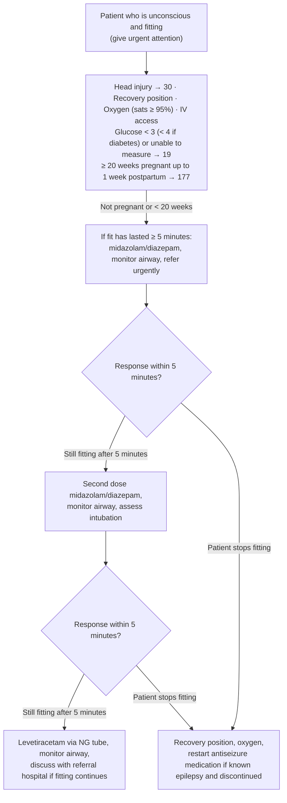

# Page 20 – Seizures/fits: flowchart

Source: APC 2026 e-book page 20 (red box; the whole page is one red box).

## Decision nodes → rules

| Node | Modelled as | Rule |
|---|---|---|
| Unconscious and fitting (red-box header) | `Seizure` (recorded warning sign) triggers a check for `Unconscious`; both together → Emergency | `Check for unconsciousness in the fitting patient`, `Emergency: unconscious and fitting (seizures/fits)` |
| Head injury → 30, low glucose → 19, pregnancy → 177 | Cross-references only; no rule | — |
| Fit lasted ≥ 5 minutes, still fitting after 5 minutes, patient stops fitting | Medication sequence (management); not modelled | — |

## Notes

- No "X likely" or "consider X" appears on the page, so there are no diagnosis rules.
